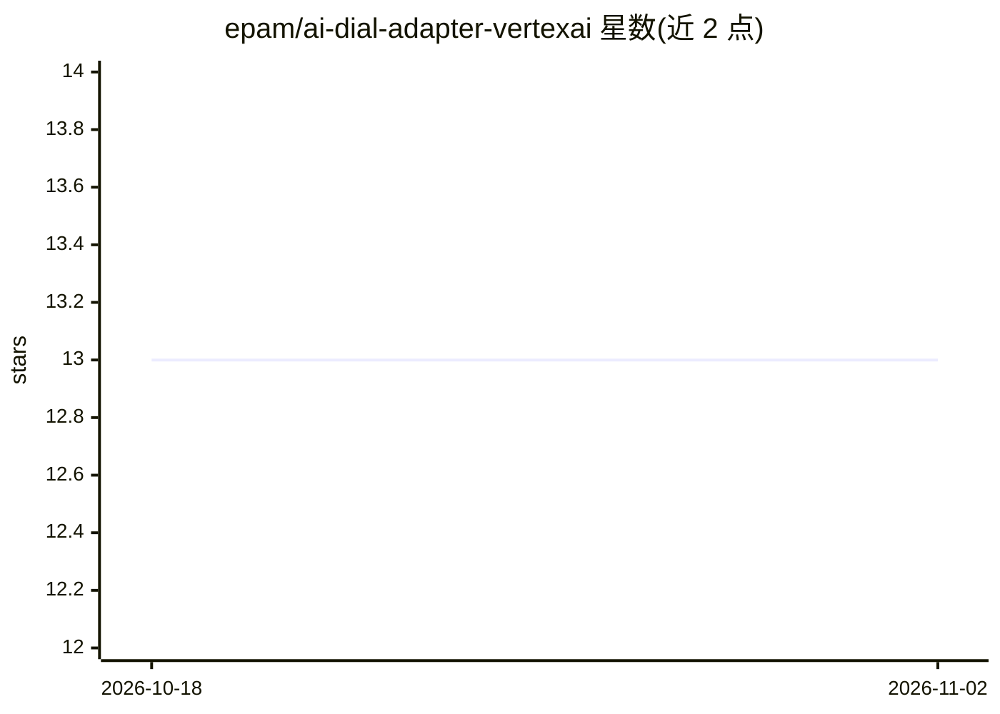

# epam/ai-dial-adapter-vertexai

⭐ 13 · Python · Apache-2.0 · 推送 2026-10-29 · [GitHub](https://github.com/epam/ai-dial-adapter-vertexai) · [官网](https://dialx.ai) · 组织维护

**为 AI DIAL 平台适配 Google Vertex AI 模型 API 的适配器**

AI DIAL 生态的 LLM 适配器：将 Vertex AI 上的语言模型、嵌入模型统一到 DIAL Core 的协议，以独立容器运行。支持 Gemini 系列（含图像生成/编辑、thinking 配置、Google Search grounding、Code Interpreter）、Claude 系列（由 aidial-adapter-anthropic 文档说明配置与 web search）、Imagen 文生图、Veo 文/图/视频生视频、Mistral 与多种嵌入模型（含多模态嵌入），并提供 tokenize、truncate_prompt、configuration 等特性端点。面向接入 DIAL 平台的开发者与企业。

## 筛选速览

| 维度 | 判定 | 备注 |
|---|---|---|
| AI 角色 | `ai-ecosystem` | LLM/agent 周边工具 |
| 许可风险 | `permissive` | Apache-2.0 |
| 部署形态 | `None` |  |
| 模型依赖 | — | README 未给出锁定关系 |
| 硬件要求 | — | 无带数字的原话,不猜 |
| 安装摩擦 | `medium` | 含编译或系统依赖之一 |
| 成熟度 | — | 结构信号不足 |

## 能力要点

- 支持 Gemini/Claude/Imagen/Veo/Mistral 等对话、生成与嵌入模型
- 提供 /tokenize、/truncate_prompt、/configuration 特性端点
- 支持文生图、图生视频、视频生视频等多模态请求
- Gemini 支持 thinking 参数、Google Search grounding 与 Code Interpreter 工具

## 适用场景

- 在 AI DIAL 平台中接入 Vertex AI 上的 Gemini 与 Claude 模型
- 通过 DIAL 统一协议调用 Imagen 文生图与 Veo 视频生成
- 使用多模态嵌入模型（文本/图像/视频/音频）构建检索能力

## 场景标签

`模型网关` · 领域:Agent 开发

## 证据(README 行号)

> L15: LLM Adapters unify the APIs of respective LLMs to align with the Unified Protocol of DIAL Core. Each Adapter operat
> L17: The project implements AI DIAL API for language models and embedding models from Vertex AI.

## 星数曲线

2026-10-18 13 → 2026-11-02 13（+0）

---
*卡片 v1 · prompt 1.4 · 生成 2026-10-31 · 置信度 high · 依据 README sha `ff015a0cb1a7` · [字段定义](../../DATASET.md)*
