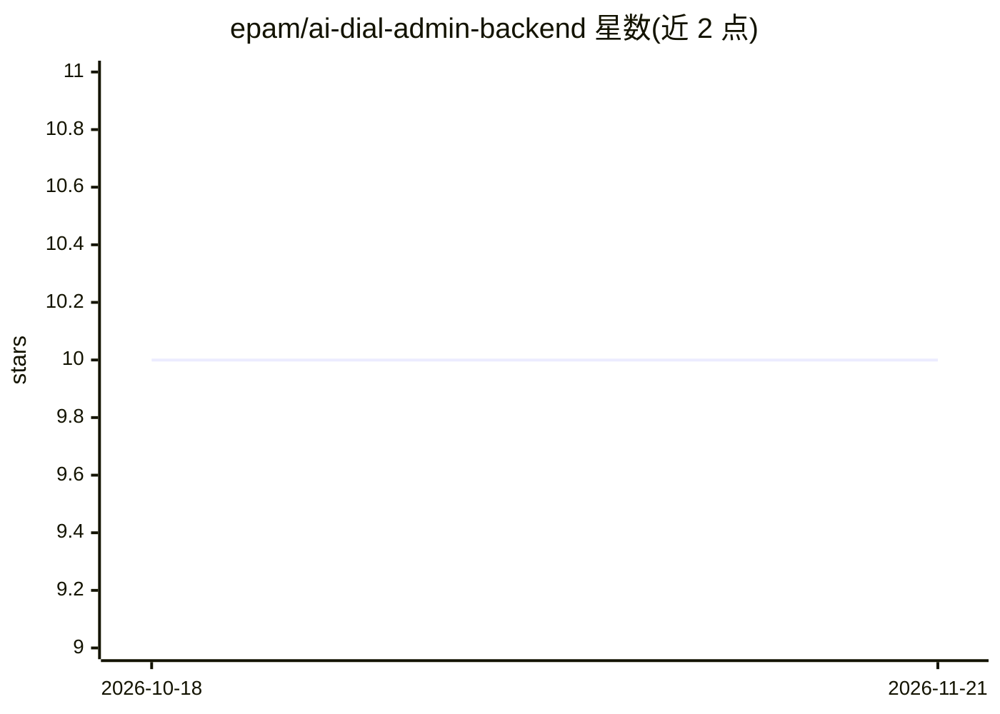

# epam/ai-dial-admin-backend

⭐ 10 · Java · Apache-2.0 · 推送 2026-11-19 · [GitHub](https://github.com/epam/ai-dial-admin-backend) · [官网](https://dialx.ai) · 组织维护

**给 DIAL Core 提供配置管理 REST API 的后台服务**

AIDIAL Admin Panel 的后端 API，基于 Java/Spring Boot，通过 REST 端点管理 dial-core 配置、公共资源与发布流程。使用 H2/PostgreSQL 等数据库做持久化，由定时任务生成兼容 dial-core 格式的 JSON 配置文件，可导出到文件系统、Kubernetes ConfigMap/Secret、Azure/AWS/GCP/Hashicorp 密钥管理等目的地。支持 Basic/JWT 认证，集成 Keycloak/AzureAD 身份管理，并提供 InfluxDB 指标查询接口。面向运维/平台管理员，需 Java 17+ 运行。

## 筛选速览

| 维度 | 判定 | 备注 |
|---|---|---|
| AI 角色 | `ai-ecosystem` | LLM/agent 周边工具 |
| 许可风险 | `permissive` | Apache-2.0 |
| 部署形态 | `self-host` | docker 或自建部署 |
| 模型依赖 | — | README 未给出锁定关系 |
| 硬件要求 | — | 无带数字的原话,不猜 |
| 安装摩擦 | `low` | 无编译、无系统依赖或容器化 |
| 成熟度 | — | 结构信号不足 |

## 能力要点

- RESTful API 管理 dial-core 配置、公共资源与发布
- 配置文件可导出至文件系统、K8s ConfigMap/Secret、Azure/AWS/GCP/Hashicorp 密钥管理
- 支持 Basic Auth 与 JWT，集成 Keycloak/AzureAD 等 IdP
- 健康监测端点与 InfluxDB 指标查询 API

## 适用场景

- 为 AIDIAL 平台集中管理模型与核心配置
- 将配置自动发布到 Kubernetes 或云密钥管理系统
- 通过企业身份系统（AzureAD/Okta 等）管控管理后台访问

## 场景标签

 · 领域:LLM 平台/基础设施管理

## 证据(README 行号)

> L7: Admin Panel API for AIDIAL Core. This API exposes REST endpoints to manage dial-core configuration.
> L23: - RESTful API for managing dial-core configurations
> L30: - DIAL core config file expot in multiple destinations (File on filesystem/Kubernetes ConfigMap/Kubernetes Secret/A

## 星数曲线

2026-10-18 10 → 2026-11-21 10（+0）

---
*卡片 v1 · prompt 1.4 · 生成 2026-11-19 · 置信度 high · 依据 README sha `791b6c4b9c29` · [字段定义](../../DATASET.md)*
