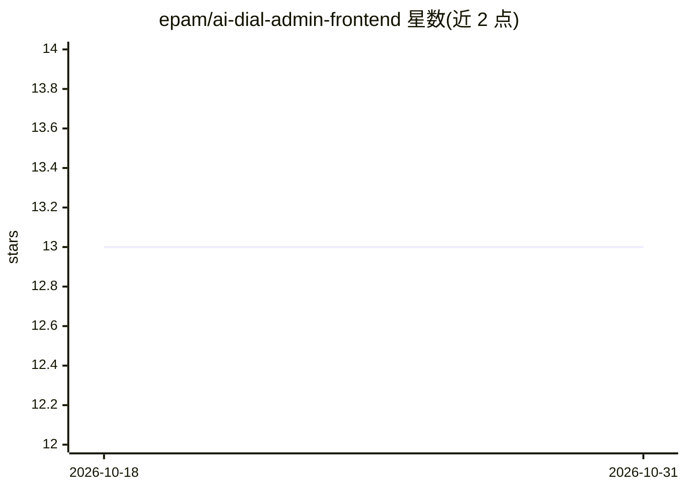

# epam/ai-dial-admin-frontend

⭐ 13 · TypeScript · Apache-2.0 · 推送 2026-10-30 · [GitHub](https://github.com/epam/ai-dial-admin-frontend) · [官网](https://dialx.ai) · 组织维护

**AI DIAL 平台的管理面板 Web 前端**

EPAM AI DIAL 生态的管理端 UI：基于 Next.js 与 NX 构建的 Web 应用，供管理员通过界面管理 AI DIAL 平台，配置项覆盖部署管理、MCP Registry、HF 模型服务、评估、分析等模块开关。通过环境变量连接 AI DIAL Admin Backend 与 DIAL Core API，支持 Auth0、Azure AD、Keycloak、GitLab、Google、PingID 等多种身份提供方认证，也支持无认证模式。运行需 Node.js 20+ 与 npm，从源码 clone 构建运行，未在 README 中说明具体功能操作细节（指向 User Guide）。

## 筛选速览

| 维度 | 判定 | 备注 |
|---|---|---|
| AI 角色 | `ai-ecosystem` | LLM/agent 周边工具 |
| 许可风险 | `permissive` | Apache-2.0 |
| 部署形态 | `self-host` | docker 或自建部署 |
| 模型依赖 | — | README 未给出锁定关系 |
| 硬件要求 | — | 无带数字的原话,不猜 |
| 安装摩擦 | `low` | 无编译、无系统依赖或容器化 |
| 成熟度 | — | 结构信号不足 |

## 能力要点

- 基于 Next.js/NX 的管理面板前端，连接 AI DIAL Admin Backend 与 DIAL Core API
- 支持 Auth0/Azure AD/Keycloak/GitLab/Google/PingID 多种认证提供方，也支持无认证模式
- 通过环境变量启用部署管理、MCP Registry、HF Model Serving、Analytics 等模块

## 适用场景

- 部署并定制 AI DIAL 平台的管理界面
- 企业内对接现有 IDP 做管理员认证
- 按需开启部署管理与模型服务管理模块

## 场景标签

 · 领域:LLM 平台管理/企业软件

## 证据(README 行号)

> L5: This project is a web application built using Next.js, a React framework with server-rendering capabilities. It can 
> L81: |`DIAL_ADMIN_API_URL`|Yes|AI DIAL Admin Backend API url. Refer to AI DIAL Admin Backend.|Any string||
> L82: |`DIAL_CORE_API_URL`|Yes|DIAL Core API url. Required for Publications, which call DIAL Core directly (forwarding th

## 星数曲线

2026-10-18 13 → 2026-10-31 13（+0）

---
*卡片 v1 · prompt 1.4 · 生成 2026-10-31 · 置信度 mid · 依据 README sha `109bc6653ced` · [字段定义](../../DATASET.md)*
