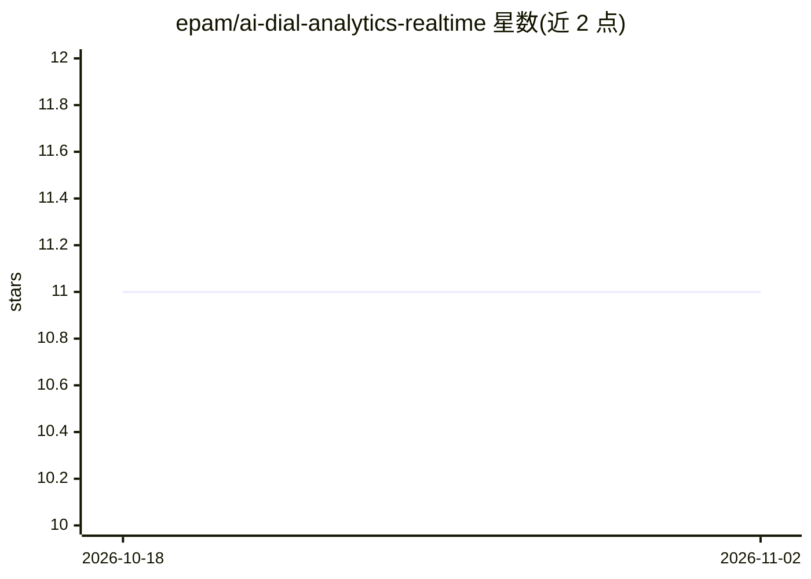

# epam/ai-dial-analytics-realtime

⭐ 11 · Python · Apache-2.0 · 推送 2026-10-29 · [GitHub](https://github.com/epam/ai-dial-analytics-realtime) · [官网](https://dialx.ai) · 组织维护

**AI DIAL 平台的实时分析服务：消费日志流写入 InfluxDB**

EPAM AI DIAL 生态的实时分析服务端：消费 AI DIAL Core 经 Vector 转发的日志流，分析对话请求并将指标写入 InfluxDB。以分布式追踪数据模型组织数据（trace_id/span_id/execution_path 还原调用树），区分 deployment_price 与累计 price 以避免多层调用重复计费；支持 OpenAI 兼容（chat/completions、embeddings、responses）与 Anthropic Messages 端点，各存入独立 measurement，记录 token 用量、缓存 token、推理 token、语言与主题检测等字段。面向部署与运维 AI DIAL 平台的开发者/企业。

## 筛选速览

| 维度 | 判定 | 备注 |
|---|---|---|
| AI 角色 | `ai-ecosystem` | LLM/agent 周边工具 |
| 许可风险 | `permissive` | Apache-2.0 |
| 部署形态 | `None` |  |
| 模型依赖 | — | README 未给出锁定关系 |
| 硬件要求 | — | 无带数字的原话,不猜 |
| 安装摩擦 | `medium` | 含编译或系统依赖之一 |
| 成熟度 | — | 结构信号不足 |

## 能力要点

- 消费 AI DIAL Core 日志流并实时写入 InfluxDB
- 分布式追踪数据模型：trace/span/execution_path 还原调用树
- deployment_price 与累计 price 区分，避免跨层调用重复计费
- 覆盖 OpenAI 兼容端点与 Anthropic Messages 端点，含 token/缓存/推理 token 指标

## 适用场景

- 监控 AI DIAL 平台各部署的调用量与 token 消耗
- 统计多应用级联调用的真实总成本
- 分析用户请求的语言、主题与对话维度指标

## 场景标签

`LLM 可观测性` · 领域:评测与运维

## 证据(README 行号)

> L15: Realtime analytics server for AI DIAL. The service consumes the logs stream from AI DIAL Core, analyzes the convers
> L25: The realtime analytics server analyzes the logs stream provided by Vector in the realtime and writes metrics to the

## 星数曲线

2026-10-18 11 → 2026-11-02 11（+0）

---
*卡片 v1 · prompt 1.4 · 生成 2026-11-02 · 置信度 high · 依据 README sha `1195456e0503` · [字段定义](../../DATASET.md)*
