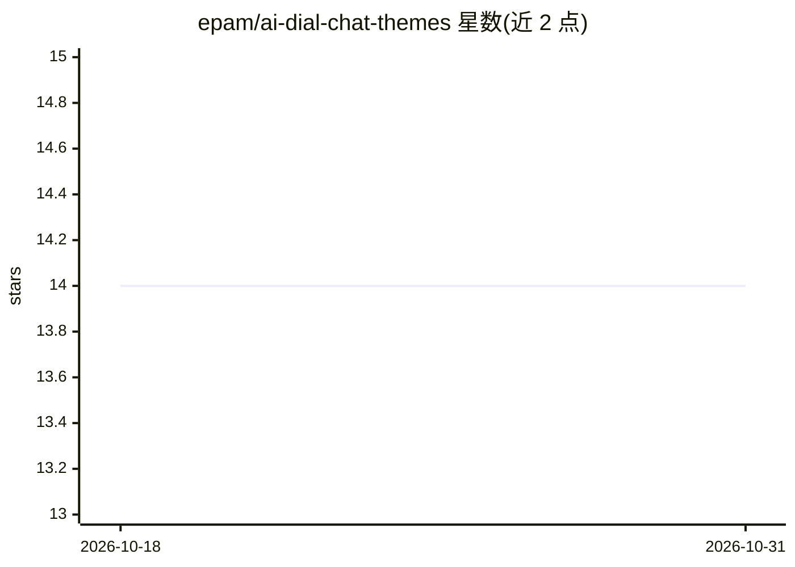

# epam/ai-dial-chat-themes

⭐ 14 · Shell · Apache-2.0 · 推送 2026-10-30 · [GitHub](https://github.com/epam/ai-dial-chat-themes) · [官网](https://dialx.ai) · 组织维护

**AI DIAL Chat 的静态主题资源托管服务：外置图片/字体/配色**

为 AI DIAL Chat 应用提供静态资源（图片、字体、调色板）的托管服务：以 Docker 容器中的 HTTP 服务器运行，通过 config.json 定义主题、图片 URL、颜色、登录页配色与横幅；AI DIAL Chat 通过 THEMES_CONFIG_HOST 环境变量拉取配置，用户在聊天应用设置中选择主题。外置资源方式使开发者与设计师可并行修改主题而无需重建聊天应用 Docker 镜像，修改后需重启聊天应用或重载页面生效。支持 Helm 部署与 OTEL 集成。

## 筛选速览

| 维度 | 判定 | 备注 |
|---|---|---|
| AI 角色 | `ai-ecosystem` | LLM/agent 周边工具 |
| 许可风险 | `permissive` | Apache-2.0 |
| 部署形态 | `library` | 以包/库形式分发 |
| 模型依赖 | — | README 未给出锁定关系 |
| 硬件要求 | — | 无带数字的原话,不猜 |
| 安装摩擦 | `low` | 无编译、无系统依赖或容器化 |
| 成熟度 | — | 结构信号不足 |

## 能力要点

- config.json 定义主题、颜色、登录页配色（authColors）与横幅（banners）
- 静态资源外置，改主题无需重建聊天应用 Docker 镜像
- 提供 make build/run 的 Docker 工作流与 Helm 部署方式
- 支持 OTEL 可观测性环境变量配置

## 适用场景

- 为自部署的 AI DIAL Chat 定制企业品牌主题与图标
- 开发团队与设计师并行迭代主题而不重建前端镜像
- 通过 Helm 在集群中部署主题静态资源服务

## 场景标签

 · 领域:LLM 应用基础设施/UI 定制

## 证据(README 行号)

> L16: > A theme is a collection of static resources including images, fonts, and color palettes that you can utilize to p
> L72: 1. Further, it is necessary to configure AI DIAL Chat to access the static resources and the themes configuration. 

## 星数曲线

2026-10-18 14 → 2026-10-31 14（+0）

---
*卡片 v1 · prompt 1.4 · 生成 2026-10-31 · 置信度 high · 依据 README sha `76b255c6212a` · [字段定义](../../DATASET.md)*
