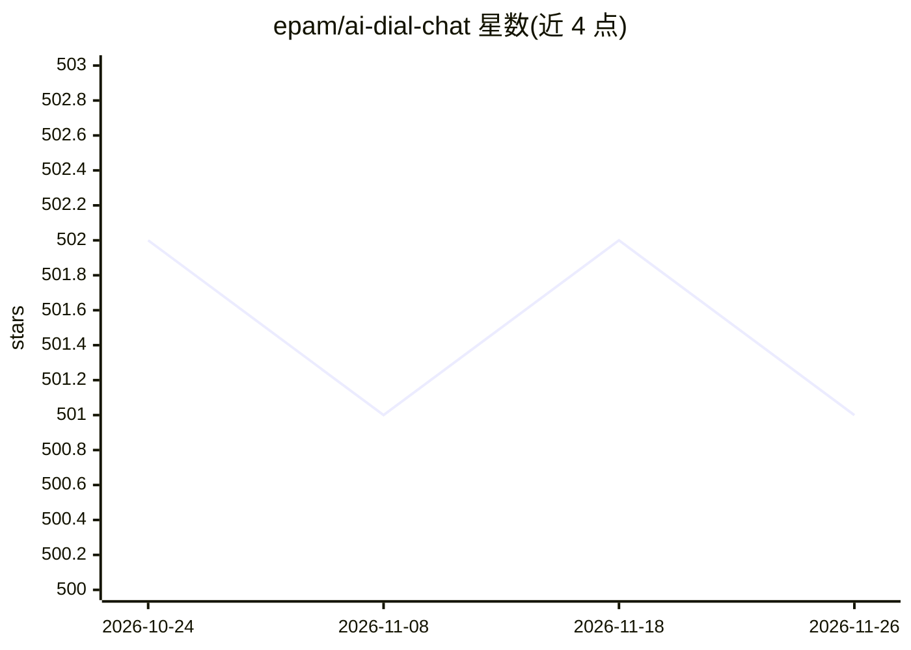

# epam/ai-dial-chat

⭐ 501 · TypeScript · Apache-2.0 · 推送 2026-11-25 · [GitHub](https://github.com/epam/ai-dial-chat) · [官网](https://chat.dialx.ai) · 组织维护

**EPAM AI DIAL 的默认聊天前端与配套 BFF 后端**

基于 Nx monorepo 的全栈聊天应用：React 前端加 NestJS 后端，对接 EPAM AI DIAL Core。前端由 libs/ 下的多个库组装（消息列表、目录、侧栏、面板等），各库通过 props 接收数据与行为；后端 chat-api 承担认证、配置与上游调用。支持 iframe 嵌入（postMessage 协议 overlay）、九种身份提供方配置、多语言与 RTL、主题 CSS 变量定制。旧版 0.x 分支维护至 2026 年底，无原地升级路径，迁移需按迁移指南执行。

## 筛选速览

| 维度 | 判定 | 备注 |
|---|---|---|
| AI 角色 | `ai-native` | 本体是模型或模型工具 |
| 许可风险 | `permissive` | Apache-2.0 |
| 部署形态 | `self-host` | docker 或自建部署 |
| 模型依赖 | — | README 未给出锁定关系 |
| 硬件要求 | — | 无带数字的原话,不猜 |
| 安装摩擦 | `low` | 无编译、无系统依赖或容器化 |
| 成熟度 | — | 结构信号不足 |

## 能力要点

- React 前端 + NestJS BFF 后端，对接 DIAL Core
- 界面由 libs/ 下可复用库组装，支持换装/重排
- iframe 嵌入聊天（postMessage 协议）并提供 Overlay Sandbox 测试页
- 九种身份提供方模板（Auth0、Azure AD、Keycloak、Okta 等）

## 适用场景

- 为 AI DIAL 部署提供面向用户的聊天界面
- 将聊天窗口以 iframe 嵌入自有页面并按 feature flag 定制
- 基于 libs/ 中的库构建定制化聊天界面

## 场景标签

`聊天机器人` · 领域:对话与助手

## 证据(README 行号)

> L3: A modern full-stack chat application built with Nx monorepo, featuring a React frontend and NestJS backend with DIAL
> L17: - **A backend-for-frontend.** The frontend no longer talks to DIAL Core
> L35: AI DIAL Chat is a comprehensive chat application platform featuring:

## 星数曲线

2026-10-24 502 → 2026-11-26 501（-1）

---
*卡片 v1 · prompt 1.4 · 生成 2026-11-25 · 置信度 high · 依据 README sha `0446e4adfd27` · [字段定义](../../DATASET.md)*
