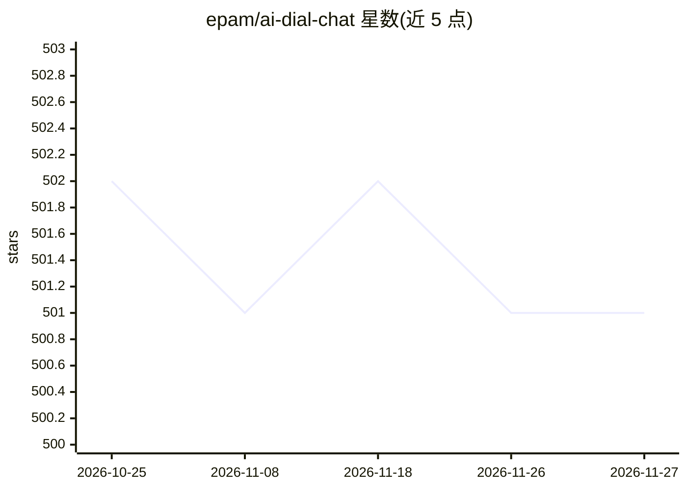

# epam/ai-dial-chat

⭐ 501 · TypeScript · Apache-2.0 · 推送 2026-11-26 · [GitHub](https://github.com/epam/ai-dial-chat) · [官网](https://chat.dialx.ai) · 组织维护

**EPAM AI DIAL 平台的默认全栈聊天界面应用**

基于 Nx monorepo 的全栈聊天应用：React 19 前端加 NestJS 后端，通过 chat-api 作为 backend-for-frontend 接入 EPAM AI DIAL Core，认证与上游调用由后端统一管理。界面由 libs/ 下的多个包（composer、消息列表、目录、侧边栏等）组合而成，可通过 props 重排或替换组件；支持 iframe overlay 嵌入宿主页面（postMessage 协议）、主题定制、多语言与 RTL。需 Node.js 24+，至少配置一个身份提供方（模板内置九种）。旧版聊天在 development-legacy 分支维护至 2026 年底。

## 筛选速览

| 维度 | 判定 | 备注 |
|---|---|---|
| AI 角色 | `ai-native` | 本体是模型或模型工具 |
| 许可风险 | `permissive` | Apache-2.0 |
| 部署形态 | `self-host` | docker 或自建部署 |
| 模型依赖 | — | README 未给出锁定关系 |
| 硬件要求 | — | 无带数字的原话,不猜 |
| 安装摩擦 | `low` | 无编译、无系统依赖或容器化 |
| 成熟度 | — | 结构信号不足 |

## 能力要点

- 由 libs/ 下可复用包组合的界面，通过 props 定制或替换
- iframe overlay 嵌入协议与 Chat Overlay Sandbox 集成试验页
- 内置九种身份提供方模板（Auth0/Azure AD/Keycloak/Okta 等）
- OpenAPI 客户端生成与 Postman 集合导出命令链

## 适用场景

- 为 AI DIAL 平台部署企业聊天界面
- 把聊天窗口以 iframe 形式嵌入自己的宿主页面的应用
- 基于 libs/ 中的 UI 包二次定制聊天界面

## 场景标签

`聊天机器人` · 领域:对话与助手

## 证据(README 行号)

> L3: A modern full-stack chat application built with Nx monorepo, featuring a React frontend and NestJS backend with DIAL
> L17: - **A backend-for-frontend.** The frontend no longer talks to DIAL Core
> L35: AI DIAL Chat is a comprehensive chat application platform featuring:

## 星数曲线

2026-10-25 502 → 2026-11-27 501（-1）

---
*卡片 v1 · prompt 1.4 · 生成 2026-11-27 · 置信度 high · 依据 README sha `2e98eef5ffd2` · [字段定义](../../DATASET.md)*
