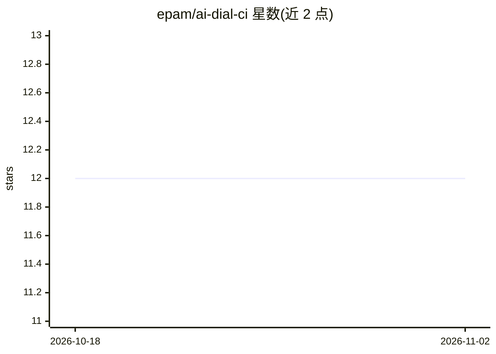

# epam/ai-dial-ci

⭐ 12 · Shell · Apache-2.0 · 推送 2026-10-29 · [GitHub](https://github.com/epam/ai-dial-ci) · [官网](https://dialx.ai) · 组织维护

**AI DIAL 组件的 GitHub Actions 复用 CI 工作流集合**

EPAM 维护的 AI DIAL 仓库组持续集成工具集：提供可导入的 PR 与 Release 工作流，覆盖 NodeJS(npm)、Java(Gradle)、Python(Poetry/UV) 及通用 Docker 项目，包含基于 git 提交历史的去重变更日志生成、RC/稳定版/补丁的分支发布策略、依赖图提交与依赖审查、PR 标题校验和通过 /deploy-review 触发的隔离评审环境 E2E 测试。使用方需按各语言提供 package.json、build.gradle、Makefile/pyproject.toml 或 Dockerfile 等约定文件。

## 筛选速览

| 维度 | 判定 | 备注 |
|---|---|---|
| AI 角色 | `ai-ecosystem` | LLM/agent 周边工具 |
| 许可风险 | `permissive` | Apache-2.0 |
| 部署形态 | `self-host` | docker 或自建部署 |
| 模型依赖 | — | README 未给出锁定关系 |
| 硬件要求 | — | 无带数字的原话,不猜 |
| 安装摩擦 | `low` | 无编译、无系统依赖或容器化 |
| 成熟度 | — | 结构信号不足 |

## 能力要点

- 覆盖 npm、Gradle、Poetry、UV、通用 Docker 的 PR/Release 复用工作流
- 基于 git 历史的变更日志自动生成（cherry-pick 去重、分组）
- GitHub 依赖图提交与 Dependency Review 自动化
- /deploy-review 斜杠命令部署评审环境并运行 E2E 测试

## 适用场景

- AI DIAL 仓库组统一 PR 检查与发布流水线
- 自动生成按 Features/Fixes 分组的变更日志与 GitHub Release
- 在临时隔离环境中对 PR 运行端到端测试

## 场景标签

 · 领域:开发工具/CI-CD

## 证据(README 行号)

> L7: Continuous Integration instrumentation for AI DIAL components.
> L9: Contains reusable workflows for AI-DIAL group of repositories under EPAM GitHub organization.

## 星数曲线

2026-10-18 12 → 2026-11-02 12（+0）

---
*卡片 v1 · prompt 1.4 · 生成 2026-11-01 · 置信度 low · 依据 README sha `43686ab76f25` · [字段定义](../../DATASET.md)*
