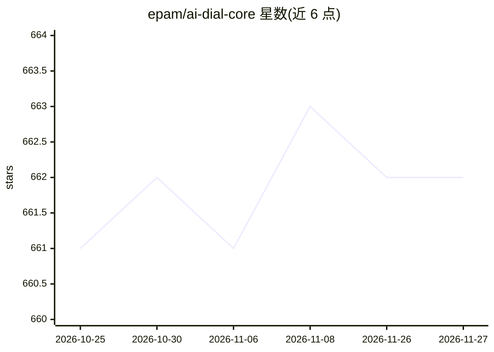

# epam/ai-dial-core

⭐ 662 · Java · Apache-2.0 · 推送 2026-11-26 · [GitHub](https://github.com/epam/ai-dial-core) · [官网](https://dialx.ai) · 组织维护

**DIAL 核心组件：为聊天补全/嵌入模型与应用提供统一 API 的 HTTP 代理**

AI DIAL 的主组件，作为 HTTP 代理向不同聊天补全与嵌入模型、助手及应用程序提供统一 REST API，基于 Java 25 与 Eclipse Vert.x 构建。自动从源码生成 OpenAPI 3.0 规范描述全部端点；支持 Gradle 构建与运行，或通过 Helm chart 部署到 Kubernetes（可部署完整 DIAL 组件栈或仅 Core）。配置分静态设置（启动时读取，含环境变量、文件与默认资源三级优先级）与动态设置；构建需提供 GitHub 凭据以访问 JClouds packages。

## 筛选速览

| 维度 | 判定 | 备注 |
|---|---|---|
| AI 角色 | `ai-ecosystem` | LLM/agent 周边工具 |
| 许可风险 | `permissive` | Apache-2.0 |
| 部署形态 | `desktop` | 安装包/桌面程序 |
| 模型依赖 | — | README 未给出锁定关系 |
| 硬件要求 | — | 无带数字的原话,不猜 |
| 安装摩擦 | `medium` | 含编译或系统依赖之一 |
| 成熟度 | — | 结构信号不足 |

## 能力要点

- 向聊天补全/嵌入模型、助手与应用提供统一 API 的 HTTP 代理
- 自动生成 OpenAPI 3.0 规范，实验性端点带 x-preview 标记
- 静态/动态两类配置，支持环境变量、设置文件与默认资源文件
- 提供 Helm chart 部署到 Kubernetes

## 适用场景

- 在企业内为多个模型与应用架设统一 API 网关
- 通过 Helm 将 DIAL 组件部署到 Kubernetes 集群
- 需要 OpenAPI 规范生成客户端代码的集成场景

## 场景标签

`模型网关` · 领域:Agent 开发

## 证据(README 行号)

> L16: > HTTP Proxy provides unified API to different chat completion and embedding models and applications.
> L64: Build the project with Gradle and Java 25:

## 星数曲线

2026-10-25 661 → 2026-11-27 662（+1）

---
*卡片 v1 · prompt 1.4 · 生成 2026-11-27 · 置信度 mid · 依据 README sha `ba152da34bee` · [字段定义](../../DATASET.md)*
