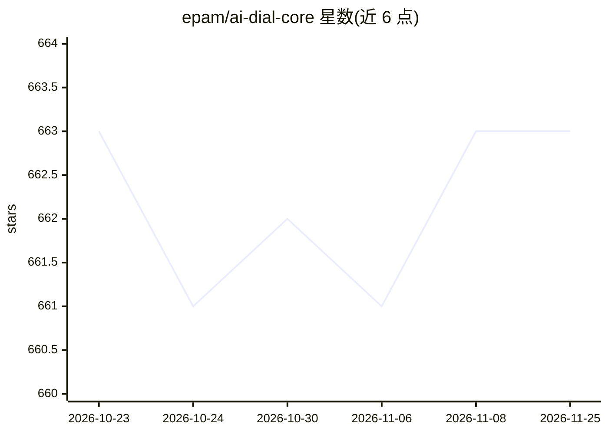

# epam/ai-dial-core

⭐ 663 · Java · Apache-2.0 · 推送 2026-11-24 · [GitHub](https://github.com/epam/ai-dial-core) · [官网](https://dialx.ai) · 组织维护

**为开发者统一代理各类聊天补全与嵌入模型的 API 网关**

AI DIAL 的核心组件：HTTP 代理服务，向上游暴露统一 API 以访问不同聊天补全与嵌入模型、助手和应用。以 Java 25 编写，构建于 Eclipse Vert.x 之上，自动生成 OpenAPI 3.0 规范描述全部 REST 端点。支持 Gradle 源码构建运行、IDE 运行和 Kubernetes 上的 Helm 部署；提供静态（启动时）与动态两类配置，覆盖插件加载、HTTP 服务器实例数、代理、API key 校验、分析与 OTel 追踪等设置。构建需提供 GitHub 凭据以访问 JClouds 包。

## 筛选速览

| 维度 | 判定 | 备注 |
|---|---|---|
| AI 角色 | `ai-ecosystem` | LLM/agent 周边工具 |
| 许可风险 | `permissive` | Apache-2.0 |
| 部署形态 | `desktop` | 安装包/桌面程序 |
| 模型依赖 | — | README 未给出锁定关系 |
| 硬件要求 | — | 无带数字的原话,不猜 |
| 安装摩擦 | `medium` | 含编译或系统依赖之一 |
| 成熟度 | — | 结构信号不足 |

## 能力要点

- 统一 API 代理聊天补全、嵌入模型、助手与应用
- 源码自动生成 OpenAPI 3.0 规范，实验端点以 x-preview 标注
- 静态/动态配置体系与插件目录加载机制
- OTel GenAI 语义约定追踪与请求头/claims 采集

## 适用场景

- 在企业内部为多个模型与应用提供统一访问入口
- 在 Kubernetes 上以 Helm 部署 DIAL 组件栈
- 为模型调用配置代理、鉴权与追踪策略

## 场景标签

`模型网关` · 领域:Agent 开发

## 证据(README 行号)

> L16: > HTTP Proxy provides unified API to different chat completion and embedding models and applications.
> L17: > Written in Java 25 and built on top of Eclipse Vert.x.
> L64: Build the project with Gradle and Java 25:

## 星数曲线

2026-10-23 663 → 2026-11-25 663（+0）

---
*卡片 v1 · prompt 1.4 · 生成 2026-11-24 · 置信度 mid · 依据 README sha `605518507a63` · [字段定义](../../DATASET.md)*
