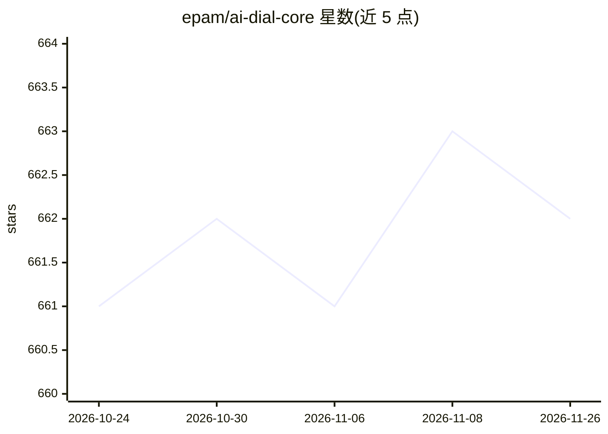

# epam/ai-dial-core

⭐ 662 · Java · Apache-2.0 · 推送 2026-11-25 · [GitHub](https://github.com/epam/ai-dial-core) · [官网](https://dialx.ai) · 组织维护

**给应用提供统一模型 API 的 AI DIAL 核心网关组件**

AI DIAL 的核心组件，以 HTTP 代理形式为聊天补全、嵌入模型、助手与应用提供统一 REST API，基于 Java 25 与 Eclipse Vert.x 构建。提供自动生成的 OpenAPI 3.0 规范，支持通过 Gradle 构建运行或 Helm chart 部署到 Kubernetes；配置分静态（环境变量/文件）与动态两类，涵盖 API key、分析日志、追踪、插件加载等设置。构建依赖 GitHub Packages 的 JClouds 包，需提供 GitHub 凭据。

## 筛选速览

| 维度 | 判定 | 备注 |
|---|---|---|
| AI 角色 | `ai-ecosystem` | LLM/agent 周边工具 |
| 许可风险 | `permissive` | Apache-2.0 |
| 部署形态 | `desktop` | 安装包/桌面程序 |
| 模型依赖 | — | README 未给出锁定关系 |
| 硬件要求 | — | 无带数字的原话,不猜 |
| 安装摩擦 | `medium` | 含编译或系统依赖之一 |
| 成熟度 | — | 结构信号不足 |

## 能力要点

- 为聊天补全与嵌入模型、助手、应用提供统一 HTTP API
- 自动生成 OpenAPI 3.0 规范（docs/open_api_core.yaml）
- 静态/动态双层配置体系，支持环境变量、文件与热重载
- 支持 Helm 部署到 Kubernetes（独立 Core 或 umbrella chart）

## 适用场景

- 为多个模型与应用接入统一的企业级 API 网关
- 在 Kubernetes 集群上部署 AI DIAL 平台核心组件
- 对模型调用做请求追踪与访问控制配置

## 场景标签

`模型网关` · 领域:Agent 开发

## 证据(README 行号)

> L16: > HTTP Proxy provides unified API to different chat completion and embedding models and applications.
> L82: You have the option to deploy the DIAL Core on the Kubernetes cluster by utilizing an _umbrella_ dial Helm chart, w

## 星数曲线

2026-10-24 661 → 2026-11-26 662（+1）

---
*卡片 v1 · prompt 1.4 · 生成 2026-11-25 · 置信度 mid · 依据 README sha `a8278c2d03fd` · [字段定义](../../DATASET.md)*
