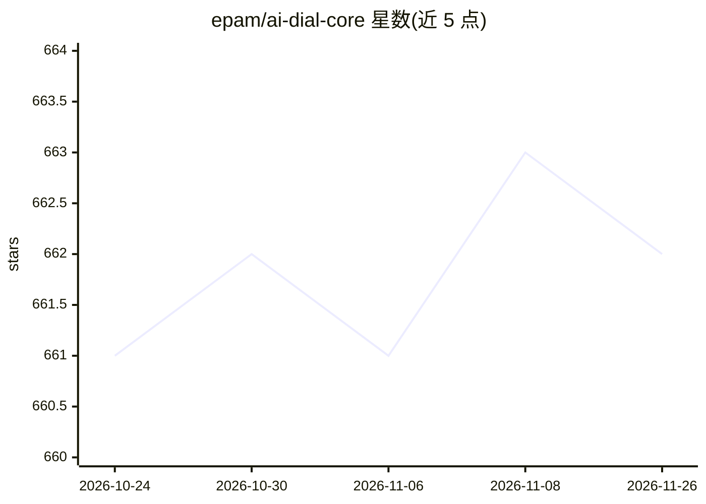

# epam/ai-dial-core

⭐ 662 · Java · Apache-2.0 · 推送 2026-11-25 · [GitHub](https://github.com/epam/ai-dial-core) · [官网](https://dialx.ai) · 组织维护

**企业级 LLM 网关：统一 API 接入聊天/嵌入模型与应用**

DIAL Core 是 AI DIAL 平台的主组件，以 HTTP 代理形式为不同 chat completion 与 embedding 模型、助手及应用提供统一 REST API；基于 Java 25 与 Eclipse Vert.x 构建，自动生成 OpenAPI 3.0 规范描述全部端点。提供静态/动态两层配置、插件加载机制、per-request API key、分析日志（含 claims/headers 采集与脱敏黑名单）、OTel GenAI 追踪等企业级运维能力；通过 Gradle 构建或 Helm chart 部署到 Kubernetes。

## 筛选速览

| 维度 | 判定 | 备注 |
|---|---|---|
| AI 角色 | `ai-ecosystem` | LLM/agent 周边工具 |
| 许可风险 | `permissive` | Apache-2.0 |
| 部署形态 | `desktop` | 安装包/桌面程序 |
| 模型依赖 | — | README 未给出锁定关系 |
| 硬件要求 | — | 无带数字的原话,不猜 |
| 安装摩擦 | `medium` | 含编译或系统依赖之一 |
| 成熟度 | — | 结构信号不足 |

## 能力要点

- 为聊天补全、嵌入模型与应用提供统一 API 的 HTTP 代理
- 自动生成 OpenAPI 3.0 规范，实验性端点带 x-preview 标记
- 静态/动态配置体系与插件目录加载机制
- OTel GenAI 追踪与分析日志，支持敏感头过滤与堆占用限制

## 适用场景

- 在企业内部为多个 LLM 模型与应用提供统一 API 入口
- 在 Kubernetes 上集中部署和管理 LLM 网关组件
- 需要对话追踪、分析日志与 API key 管理的 LLM 平台运维

## 场景标签

`模型网关` · 领域:Agent 开发

## 证据(README 行号)

> L16: > HTTP Proxy provides unified API to different chat completion and embedding models and applications.
> L17: > Written in Java 25 and built on top of Eclipse Vert.x.

## 星数曲线

2026-10-24 661 → 2026-11-26 662（+1）

---
*卡片 v1 · prompt 1.4 · 生成 2026-11-26 · 置信度 mid · 依据 README sha `8ed5e092c1fe` · [字段定义](../../DATASET.md)*
