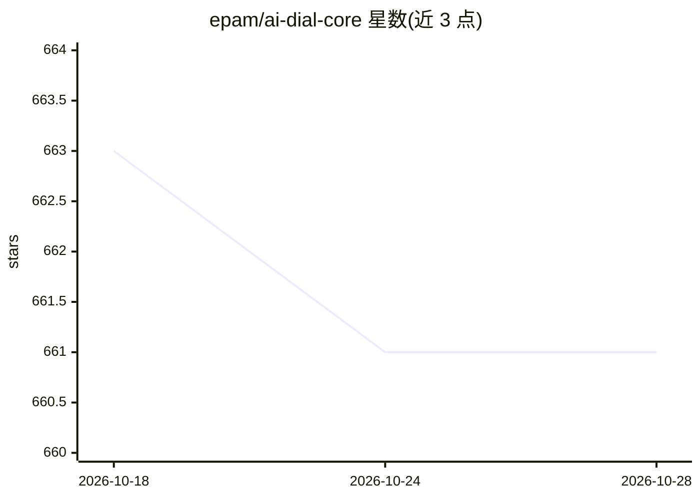

# epam/ai-dial-core

⭐ 661 · Java · Apache-2.0 · 推送 2026-10-27 · [GitHub](https://github.com/epam/ai-dial-core) · [官网](https://dialx.ai) · 组织维护

**AI DIAL 核心组件：为多种 LLM 与应用提供统一 API 的 HTTP 代理**

用 Java 21 基于 Eclipse Vert.x 编写的 HTTP 代理服务，向不同的 chat completion 与 embedding 模型、助手及应用暴露统一 API。提供自动生成的 OpenAPI 3.0 规范描述全部 REST 端点；通过 Gradle 构建运行，需配置 GitHub 凭据访问 JClouds 包；支持以 Helm chart 部署到 Kubernetes。配置分为静态与动态两类，覆盖出站代理、身份提供方（JWKS）、分析日志、OpenTelemetry 追踪、MCP 客户端等；标记 x-preview 的端点为实验性且不保证向后兼容。

## 筛选速览

| 维度 | 判定 | 备注 |
|---|---|---|
| AI 角色 | `ai-ecosystem` | LLM/agent 周边工具 |
| 许可风险 | `permissive` | Apache-2.0 |
| 部署形态 | `desktop` | 安装包/桌面程序 |
| 模型依赖 | — | README 未给出锁定关系 |
| 硬件要求 | — | 无带数字的原话,不猜 |
| 安装摩擦 | `medium` | 含编译或系统依赖之一 |
| 成熟度 | — | 结构信号不足 |

## 能力要点

- 统一 API 代理多种 chat completion / embedding 模型、助手与应用
- 从源码自动生成的 OpenAPI 3.0 规范（docs/open_api_core.yaml）
- 支持 Kubernetes Helm 部署（umbrella dial chart 或单独 dial-core chart）
- 静态/动态双层配置，覆盖身份提供方、出站代理、OTel 追踪、MCP 客户端等

## 适用场景

- 在企业内统一接入多家模型供应商的 API
- 为 DIAL 生态提供核心网关组件
- 在 Kubernetes 集群上部署模型代理并配置身份认证

## 场景标签

`模型网关` · 领域:Agent 开发

## 证据(README 行号)

> L16: > HTTP Proxy provides unified API to different chat completion and embedding models and applications.
> L17: > Written in Java 21 and built on top of Eclipse Vert.x.

## 星数曲线

2026-10-18 663 → 2026-10-28 661（-2）

---
*卡片 v1 · prompt 1.4 · 生成 2026-10-22 · 置信度 high · 依据 README sha `d0e45c06697e` · [字段定义](../../DATASET.md)*
