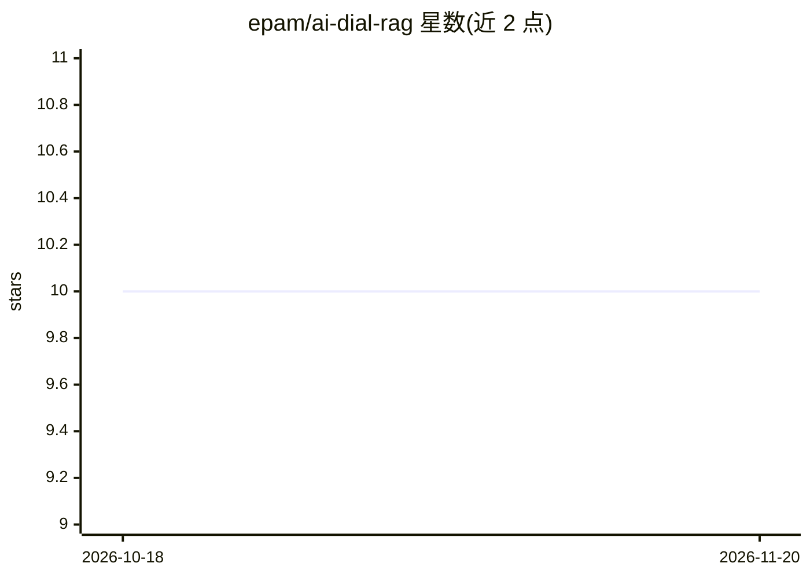

# epam/ai-dial-rag

⭐ 10 · Python · Apache-2.0 · 推送 2026-11-12 · [GitHub](https://github.com/epam/ai-dial-rag) · [官网](https://dialx.ai) · 组织维护

**面向 Dial 环境的多检索方式文档问答系统**

运行于 EPAM AI DIAL 环境中的文档问答应用：用户上传 PDF/DOCX/PPTX/TXT 及图片格式文档后，系统通过四种检索方式（视觉模型页面描述、多模态嵌入、文本语义嵌入、BM25 关键词）定位信息并生成回答。部署依赖 Dial Core 访问 LLM 与文件存储，通过 YAML 配置文件与环境变量适配 AWS/Azure/GCP 等不同模型环境，支持文本-only 模式以配合不支持图像输入的模型。README 未给出独立的本地安装路径。

## 筛选速览

| 维度 | 判定 | 备注 |
|---|---|---|
| AI 角色 | `ai-native` | 本体是模型或模型工具 |
| 许可风险 | `permissive` | Apache-2.0 |
| 部署形态 | `self-host` | docker 或自建部署 |
| 模型依赖 | — | README 未给出锁定关系 |
| 硬件要求 | — | 无带数字的原话,不猜 |
| 安装摩擦 | `low` | 无编译、无系统依赖或容器化 |
| 成熟度 | — | 结构信号不足 |

## 能力要点

- 四种检索方式：页面描述、多模态嵌入、语义嵌入、BM25 关键词
- 预置 AWS/Azure/GCP 及混合环境的配置文件，可自定义或环境变量覆盖
- 支持 Dial File Storage 或本地/内存索引存储
- 提供历史对话、system prompt 覆盖、调试命令等运行时配置项

## 适用场景

- 在 Dial 环境中部署企业文档问答服务
- 对含图片页面的 PDF/PPT 文档做图文检索问答
- 按可用模型（Claude/GPT/Gemini）切换检索与生成配置

## 场景标签

`文档问答` · 领域:知识与检索

## 证据(README 行号)

> L5: The Dial RAG answers user questions using information from the documents provided by user. It supports the following
> L7: The Dial RAG implements several retrieval methods to find the relevant information:
> L14: The Dial RAG is intended to be used in the Dial environment. It uses the Dial Core to access the LLMs and other ser

## 星数曲线

2026-10-18 10 → 2026-11-20 10（+0）

---
*卡片 v1 · prompt 1.4 · 生成 2026-11-19 · 置信度 high · 依据 README sha `79411cfdc811` · [字段定义](../../DATASET.md)*
