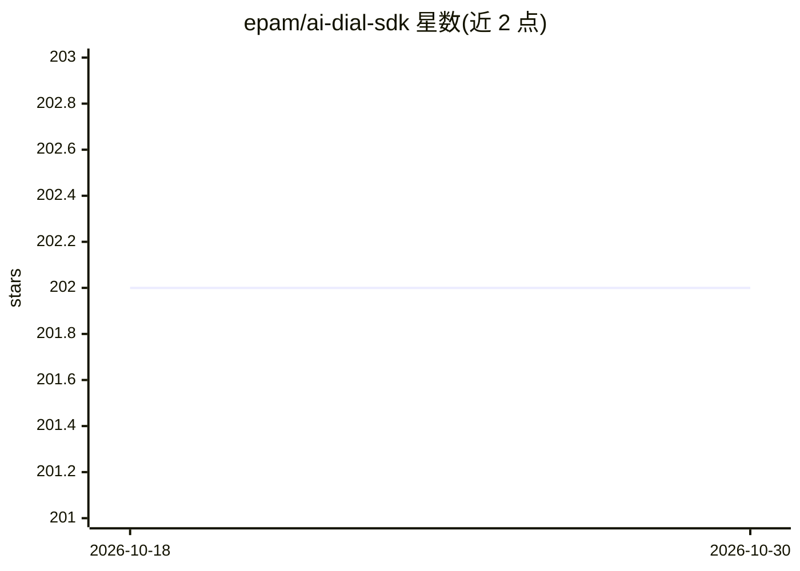

# epam/ai-dial-sdk

⭐ 202 · Python · Apache-2.0 · 推送 2026-10-29 · [GitHub](https://github.com/epam/ai-dial-sdk) · [官网](https://dialx.ai) · 组织维护

**AI DIAL 的 Python SDK：构建应用与模型适配器**

EPAM AI DIAL 平台的 Python 框架，用于创建应用与模型适配器，产物兼容基于 Azure OpenAI API 设计的 AI DIAL API。以 Python 库（aidial-sdk）通过 pip 安装，每个 deployment 同时暴露 DIAL 路径与 Azure OpenAI v1 路径，提供 chat/completions、embeddings、rate、tokenize 等端点，支持流式 SSE 心跳、请求头代理与 Pydantic V1/V2 双版本切换等环境变量配置。开发环境要求 Python ≥3.11 与 Poetry ≥2.1.1，提供 make 脚本完成初始化、lint、测试与发布。

## 筛选速览

| 维度 | 判定 | 备注 |
|---|---|---|
| AI 角色 | `ai-ecosystem` | LLM/agent 周边工具 |
| 许可风险 | `permissive` | Apache-2.0 |
| 部署形态 | `library` | 以包/库形式分发 |
| 模型依赖 | — | README 未给出锁定关系 |
| 硬件要求 | — | 无带数字的原话,不猜 |
| 安装摩擦 | `medium` | 含编译或系统依赖之一 |
| 成熟度 | — | 结构信号不足 |

## 能力要点

- 创建兼容 AI DIAL API（基于 Azure OpenAI API 设计）的应用与模型适配器
- 每个 deployment 同时暴露 /openai/deployments 与 /openai/v1 两种基路径
- 提供 chat/completions、embeddings、tokenize、truncate_prompt 等端点
- 环境变量支持 SSE 心跳插入、请求头代理与 Pydantic V1/V2 切换

## 适用场景

- 为 AI DIAL 平台开发自定义 LLM 应用
- 将自有模型封装为 AI DIAL 兼容的模型适配器
- 构建兼容 Azure OpenAI v1 API 路径的服务

## 场景标签

`Agent 框架` · 领域:Agent 开发

## 证据(README 行号)

> L18: Framework to create applications and model adapters for AI DIAL.
> L20: Applications and model adapters implemented using this framework will be compatible with AI DIAL API that was desig

## 星数曲线

2026-10-18 202 → 2026-10-30 202（+0）

---
*卡片 v1 · prompt 1.4 · 生成 2026-10-22 · 置信度 high · 依据 README sha `bd1da4bc4cf3` · [字段定义](../../DATASET.md)*
