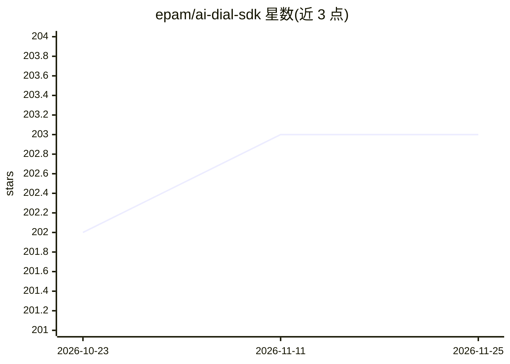

# epam/ai-dial-sdk

⭐ 203 · Python · Apache-2.0 · 推送 2026-11-17 · [GitHub](https://github.com/epam/ai-dial-sdk) · [官网](https://dialx.ai) · 组织维护

**为 AI DIAL 平台构建应用与模型适配器的 Python SDK**

EPAM 维护的 Python 框架，用于开发 AI DIAL 平台的应用与模型适配器；基于该框架实现的部署兼容 AI DIAL API（设计基于 Azure OpenAI API）。暴露 chat/completions、rate、tokenize、truncate_prompt、configuration、embeddings 等端点，支持流式响应心跳、请求头代理等环境变量配置，并提供将 Anthropic Messages 请求翻译为 Chat Completions 的转换器（需 translators 扩展与 Pydantic V2）。开发侧要求 Python ≥3.11 与 Poetry ≥2.1.1，通过 Makefile 完成初始化、lint、测试、构建与发布。

## 筛选速览

| 维度 | 判定 | 备注 |
|---|---|---|
| AI 角色 | `ai-ecosystem` | LLM/agent 周边工具 |
| 许可风险 | `permissive` | Apache-2.0 |
| 部署形态 | `library` | 以包/库形式分发 |
| 模型依赖 | — | README 未给出锁定关系 |
| 硬件要求 | — | 无带数字的原话,不猜 |
| 安装摩擦 | `medium` | 含编译或系统依赖之一 |
| 成熟度 | — | 结构信号不足 |

## 能力要点

- 构建兼容 AI DIAL API 的应用与模型适配器
- 支持 chat/completions、embeddings、tokenize 等多端点
- 提供 Anthropic Messages 到 Chat Completions 的转换器
- 支持流式响应心跳与请求头代理配置

## 适用场景

- 为 AI DIAL 平台开发自定义 LLM 应用
- 将只支持 Chat Completions 的模型接入 Anthropic 原生客户端
- 为平台接入自定义模型编写适配器

## 场景标签

`模型网关` · 领域:Agent 开发

## 证据(README 行号)

> L18: Framework to create applications and model adapters for AI DIAL.
> L20: Applications and model adapters implemented using this framework will be compatible with AI DIAL API that was desig

## 星数曲线

2026-10-23 202 → 2026-11-25 203（+1）

---
*卡片 v1 · prompt 1.4 · 生成 2026-11-25 · 置信度 high · 依据 README sha `9c3fa9797cfe` · [字段定义](../../DATASET.md)*
