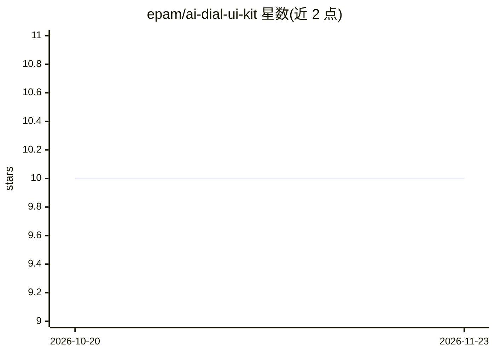

# epam/ai-dial-ui-kit

⭐ 10 · TypeScript · Apache-2.0 · 推送 2026-11-22 · [GitHub](https://github.com/epam/ai-dial-ui-kit) · [官网](https://dialx.ai) · 组织维护

**为开发者构建 AI DIAL 界面的 React 组件库**

EPAM 发布的生产级 React 组件库（TypeScript 编写，Apache 2.0），用于构建 AI DIAL 界面。提供 Buttons、Inputs、Dropdowns 等基础组件与设计系统 2.0 组件，支持通过 CSS 自定义属性做主题定制、覆盖层级（z-index ladder）管理，并导出稳定 class 名供宿主应用定向样式覆盖。以 npm 包分发，配套 Storybook 文档、Vitest 测试（覆盖率 70%+）与开发环境脚手架。

## 筛选速览

| 维度 | 判定 | 备注 |
|---|---|---|
| AI 角色 | `ai-enhanced` | 去掉 AI 部分产品仍成立 |
| 许可风险 | `permissive` | Apache-2.0 |
| 部署形态 | `library` | 以包/库形式分发 |
| 模型依赖 | — | README 未给出锁定关系 |
| 硬件要求 | — | 无带数字的原话,不猜 |
| 安装摩擦 | `low` | 无编译、无系统依赖或容器化 |
| 成熟度 | — | 结构信号不足 |

## 能力要点

- npm 包形式分发，供 React 应用集成
- CSS 自定义属性主题定制与四步 overlay 层级管理
- 导出 DIAL_KIT_CLASS 稳定 class 名，供宿主覆盖样式
- Storybook 文档与测试覆盖 70%+

## 适用场景

- 为 AI DIAL 应用搭建统一风格的界面
- 企业品牌化定制组件主题与圆角
- 用 Storybook 浏览与调试组件

## 场景标签

 · 领域:前端开发/UI 组件

## 证据(README 行号)

> L8: The AI DIAL UI Kit is an production-ready React component library designed to streamline your development process. I
> L19: - 🎨 **Unified User Experience**: Ui Kit usage helps with design consistency across AI DIAL applications
> L41: npm install @epam/ai-dial-ui-kit

## 星数曲线

2026-10-20 10 → 2026-11-23 10（+0）

---
*卡片 v1 · prompt 1.4 · 生成 2026-11-19 · 置信度 high · 依据 README sha `b62583488653` · [字段定义](../../DATASET.md)*
