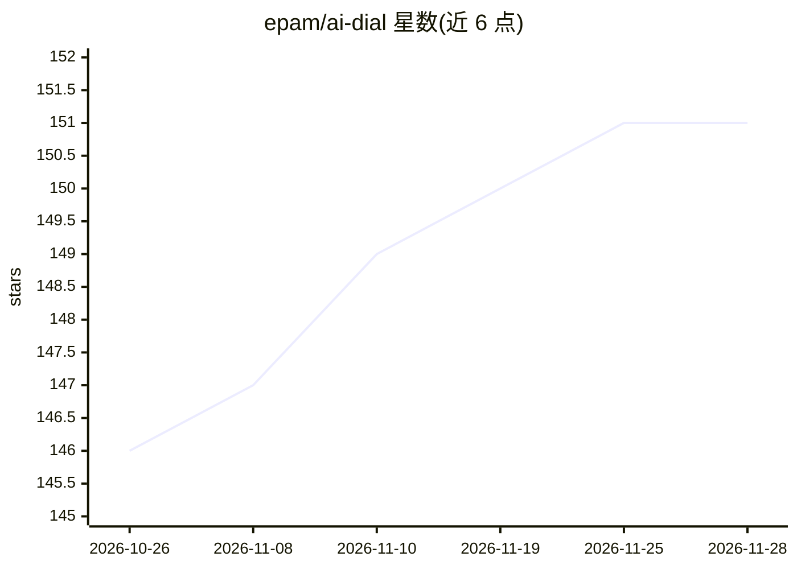

# epam/ai-dial

⭐ 151 · TypeScript · Apache-2.0 · 推送 2026-11-27 · [GitHub](https://github.com/epam/ai-dial) · [官网](https://docs.dialx.ai/) · 组织维护

**EPAM 开源企业级 AI 平台 DIAL 的官方文档站**

本仓库是 DIAL 平台文档（docs.dialx.ai）的源码，用 Docusaurus 构建，附带示例应用与适配器教程成品。DIAL 本体由多个仓库组成：核心组件 DIAL Core 提供 OpenAI 兼容的统一 API 网关，统一管理访问控制、用量与成本限制及可观测性；配套 DIAL Chat 网页端、DIAL Admin 管理控制台、各家模型适配器、SDK 与评测、RAG 应用等组件。可通过 Docker 本地运行整套平台或使用托管版，无需 API key 的样例内置小型开源模型。

## 筛选速览

| 维度 | 判定 | 备注 |
|---|---|---|
| AI 角色 | `ai-ecosystem` | LLM/agent 周边工具 |
| 许可风险 | `permissive` | Apache-2.0 |
| 部署形态 | `library` | 以包/库形式分发 |
| 模型依赖 | locked-api |  |
| 硬件要求 | — | 无带数字的原话,不猜 |
| 安装摩擦 | `low` | 无编译、无系统依赖或容器化 |
| 成熟度 | — | 结构信号不足 |

## 能力要点

- DIAL Core 提供 OpenAI 兼容统一 API，集中管理访问控制、成本限制与可观测性
- 提供 Azure OpenAI、AWS Bedrock、Vertex AI、Anthropic 等模型适配器
- Docker 本地样例内置小型开源模型，无需 API key 与云账号
- 配套 Python/TypeScript SDK、Helm 部署图表与 Terraform Provider

## 适用场景

- 为企业统一接入多家模型供应商并集中管理权限与成本
- 在组织内部署带管理面板与聊天界面的 AI 平台
- 在统一 API 之上构建应用、agent 与 RAG 问答

## 场景标签

`教程课程` `模型网关` · 领域:Agent 开发

## 证据(README 行号)

> L18: **DIAL** (Deterministic Integrator of Applications and Language Models) is an open-source, enterprise-grade AI plat
> L61: |DIAL Core|The central and only required component. An API gateway that exposes the Unified API to models, applicat

## 星数曲线

2026-10-26 146 → 2026-11-28 151（+5）

---
*卡片 v1 · prompt 1.4 · 生成 2026-11-27 · 置信度 high · 依据 README sha `b3562470865a` · [字段定义](../../DATASET.md)*
