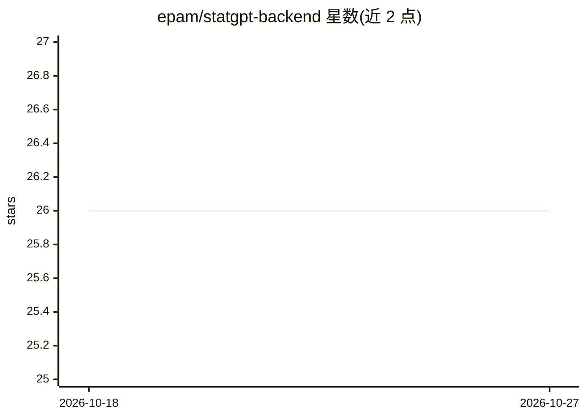

# epam/statgpt-backend

⭐ 26 · Python · MIT · 推送 2026-10-26 · [GitHub](https://github.com/epam/statgpt-backend) · [官网](https://statgpt.dialx.ai) · 组织维护

**统计问答应用 StatGPT 的后端：基于 LLM 生成回答**

EPAM 维护的 StatGPT 应用后端，用 Python 3.11 编写，实现 API 与主逻辑。技术栈包括 AI DIAL SDK、FastAPI、SQLAlchemy、LangChain、Pydantic 与 sdmx1（SDMX 数据处理与数据提供方连接）。包含四个模块：admin 数据管理后端、common 公共代码、app 主应用（基于 LLM 与 admin 准备的数据生成回答）、cli 管理命令行。主应用内置 MCP server，可向 Claude Code、Cursor 等外部 MCP 客户端暴露 SupremeAgent 工具；Admin 另有可选的 Beta MCP server 辅助数据集导入。本地运行依赖 Make、Python 3.11、Poetry、Docker Engine/Compose，本地化需 GNU gettext。

## 筛选速览

| 维度 | 判定 | 备注 |
|---|---|---|
| AI 角色 | `ai-native` | 本体是模型或模型工具 |
| 许可风险 | `permissive` | MIT |
| 部署形态 | `self-host` | docker 或自建部署 |
| 模型依赖 | — | README 未给出锁定关系 |
| 硬件要求 | — | 无带数字的原话,不猜 |
| 安装摩擦 | `low` | 无编译、无系统依赖或容器化 |
| 成熟度 | — | 结构信号不足 |

## 能力要点

- 主应用基于 LLM 与 SDMX 数据生成回答
- 内置 MCP server 向 Claude Code、Cursor 等客户端暴露工具
- Admin 后端支持数据添加与更新，附带数据去重、频道重建索引的 CLI
- 技术栈：AI DIAL SDK、FastAPI、SQLAlchemy、LangChain、sdmx1

## 适用场景

- 搭建统计数据的自然语言问答服务后端
- 通过 MCP 客户端调用 StatGPT 的数据问答工具
- 管理统计内容源：初始化、重建索引、去重

## 场景标签

`数据分析` · 领域:效率与自动化

## 证据(README 行号)

> L3: This repository contains code for StatGPT backend, which implements APIs and main logic of the StatGPT application.
> L25: * `statgpt/app` — main application that generates response using LLMs and based on data prepared by `statgpt.admin`

## 星数曲线

2026-10-18 26 → 2026-10-27 26（+0）

---
*卡片 v1 · prompt 1.4 · 生成 2026-10-26 · 置信度 high · 依据 README sha `eaab48fc68ef` · [字段定义](../../DATASET.md)*
