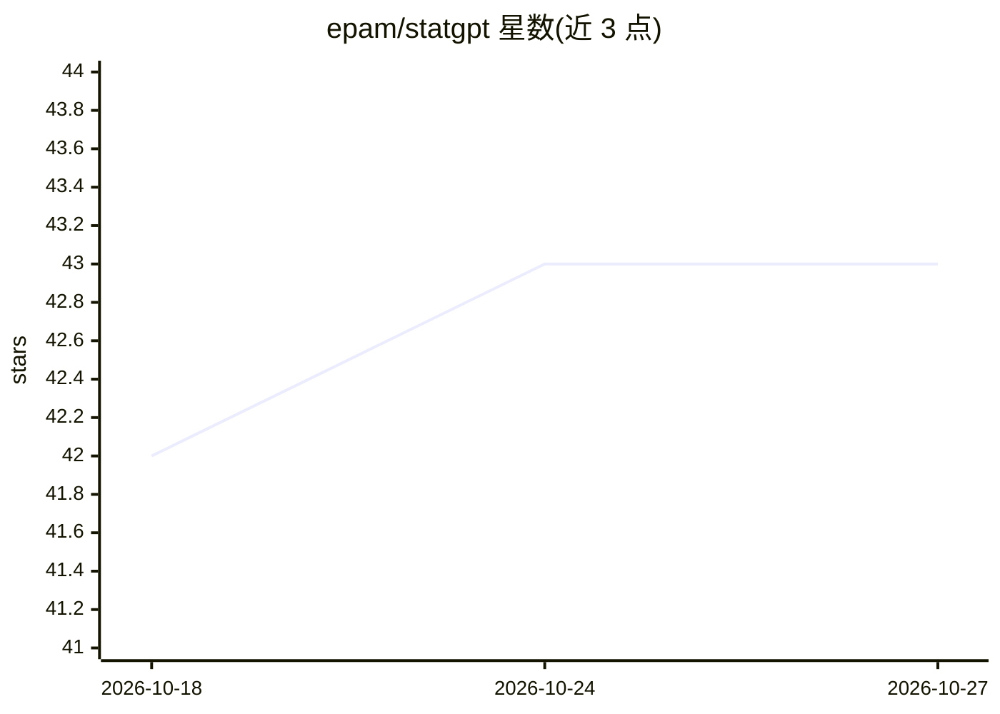

# epam/statgpt

⭐ 43 · Python · MIT · 推送 2026-08-11 · [GitHub](https://github.com/epam/statgpt) · [官网](https://statgpt.dialx.ai) · 组织维护

**面向官方统计数据的自然语言问答平台（Talk-To-Your-Data）**

EPAM 维护的 AI 数据问答平台：用户以自然语言查询官方统计数据，系统基于 SDMX 协议处理统计数据库，支持多来源指标发现、自动数据可视化，并通过数据接地减少幻觉。平台构建在 AI DIAL 企业 AI 平台之上，提供 Chat 后端、Admin 前端、Portal UI 库与 GTDC 门户实现等多个源仓库；部署提供 Kubernetes Helm Chart、通用安装与 Azure 安装路径，支持 Entra ID 认证。另通过 MCP 协议向 Claude、Cursor 等 AI agent 暴露通道工具。

## 筛选速览

| 维度 | 判定 | 备注 |
|---|---|---|
| AI 角色 | `ai-native` | 本体是模型或模型工具 |
| 许可风险 | `permissive` | MIT |
| 部署形态 | `library` | 以包/库形式分发 |
| 模型依赖 | — | README 未给出锁定关系 |
| 硬件要求 | — | 无带数字的原话,不猜 |
| 安装摩擦 | `low` | 无编译、无系统依赖或容器化 |
| 成熟度 | — | 结构信号不足 |

## 能力要点

- 自然语言查询官方统计数据，SDMX-native 数据处理
- 多来源指标发现与自动数据可视化，数据接地防幻觉
- 通过 MCP 协议向 AI agent 提供 agentic 访问
- 基于 AI DIAL 平台，提供 Helm Chart 与 Azure 部署路径

## 适用场景

- 以对话方式查询官方统计数据库指标
- 在 GTDC（全球可信数据共同体）门户中使用统计问答
- 通过 Claude/Cursor 等 agent 以 MCP 工具访问统计通道

## 场景标签

`数据分析` · 领域:效率与自动化

## 证据(README 行号)

> L3: **StatGPT** is an AI-driven Talk-To-Your-Data platform that enables users to interact with official statistics data
> L11: - SDMX-native data processing

## 星数曲线

2026-10-18 42 → 2026-10-27 43（+1）

---
*卡片 v1 · prompt 1.4 · 生成 2026-10-25 · 置信度 high · 依据 README sha `604d8d9eeb2b` · [字段定义](../../DATASET.md)*
