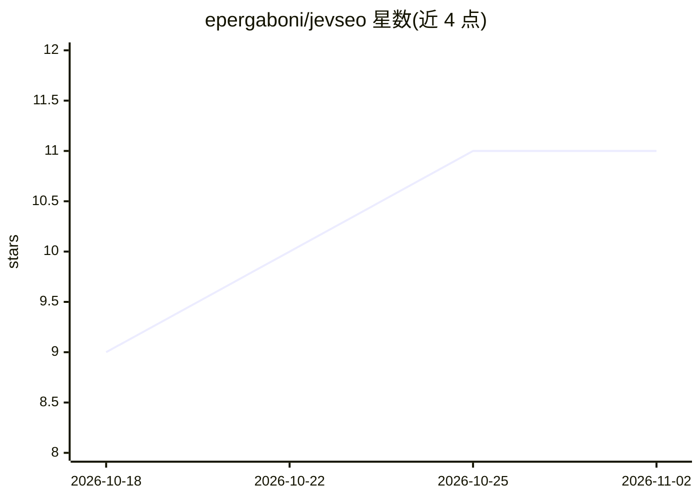

# epergaboni/jevseo

⭐ 11 · TypeScript · MIT · 推送 2026-09-21 · [GitHub](https://github.com/epergaboni/jevseo) · [官网](https://jevseo.epergaboni.com/) · 个人维护

**面向开发者的 SEO/AEO/GEO 页面评分工具：可审计的模型判定**

基于 Next.js 的自托管网页评分应用：输入 URL 或草稿，输出 SEO、AEO、GEO 三个分数及按可恢复分数排序的修复清单。机制上区分规则（代码中固定阈值）、判定（交给 Jev——System One 决策模型，返回校准概率分布而非文本）与策略（权重合成，70/30 混合）；置信度低于 0.55 标记需人工核查。整站模式可爬取域名、对每页做 leave/improve/rewrite/merge/split/prune 决策并生成计划。需自备 TypeSafe API key；DataForSEO 为可选 SERP 对比；数据存于本地 SQLite 或 Postgres。git clone + pnpm 本地运行。

## 筛选速览

| 维度 | 判定 | 备注 |
|---|---|---|
| AI 角色 | `ai-native` | 本体是模型或模型工具 |
| 许可风险 | `permissive` | MIT |
| 部署形态 | `library` | 以包/库形式分发 |
| 模型依赖 | — | README 未给出锁定关系 |
| 硬件要求 | — | 无带数字的原话,不猜 |
| 安装摩擦 | `low` | 无编译、无系统依赖或容器化 |
| 成熟度 | — | 结构信号不足 |

## 能力要点

- 三分数（SEO/AEO/GEO）+ 带证据的排序修复清单
- 规则/判定/策略三层分离：代码管规则，Jev 模型管语义判定，返回概率分布与独立置信度轴
- 整站模式：爬取、45 信号评分、类型化决策与重叠页检测，生成统一优先级计划
- 本地运行，key 留在本机；SQLite 单文件存储，支持切换 Postgres

## 适用场景

- 发布前检查页面在搜索、精选摘要与 AI 引擎引用三方面的表现
- 整站审计：决定哪些页面该改进、合并、拆分或删除
- 对比竞争对手 SERP 前十，评估格式与覆盖差距（可选）

## 场景标签

`数据分析` `网页抓取` · 领域:效率与自动化

## 证据(README 行号)

> L3: **Score a page for search, answer engines and generative engines — with judgments you can audit.**
> L36: Jev is a **System One** model. It does not
> L55: - **One request for everything.** Jev reads the state once and answers all 25 questions in

## 星数曲线

2026-10-18 9 → 2026-11-02 11（+2）

---
*卡片 v1 · prompt 1.4 · 生成 2026-11-02 · 置信度 mid · 依据 README sha `aeb2513aabff` · [字段定义](../../DATASET.md)*
