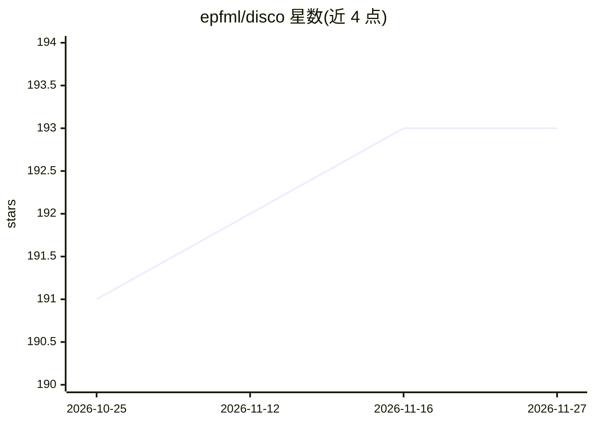

# epfml/disco

⭐ 193 · TypeScript · Apache-2.0 · 推送 2026-11-26 · [GitHub](https://github.com/epfml/disco) · [官网](https://discolab.ai) · 组织维护

**非技术用户在浏览器中协作训练模型且不共享私有数据**

DISCO 是一个免安装的浏览器平台（提供网页与移动端），基于联邦学习与去中心化学习，让多个数据所有者在不共享原始数据的前提下共同训练机器学习模型：模型公开、数据私有，通信的是模型更新而非数据，更新经安全聚合得到训练后的模型。平台通过 TF.js 在浏览器内运行深度学习任务，去中心化模式经由 WebRTC 点对点通信。用户可在 DISCOllaboratives 页面使用内置示例任务（GPT2、Titanic、MNIST、CIFAR-10），也可在无代码的自定义训练页上传初始模型并选择联邦或去中心化训练方案。

## 筛选速览

| 维度 | 判定 | 备注 |
|---|---|---|
| AI 角色 | `ai-native` | 本体是模型或模型工具 |
| 许可风险 | `permissive` | Apache-2.0 |
| 部署形态 | `None` |  |
| 模型依赖 | — | README 未给出锁定关系 |
| 硬件要求 | — | 无带数字的原话,不猜 |
| 安装摩擦 | `medium` | 含编译或系统依赖之一 |
| 成熟度 | — | 结构信号不足 |

## 能力要点

- public model – private data 方案：仅通信模型更新，更新安全聚合
- 浏览器内经 TF.js 运行深度学习任务，免安装
- 去中心化模式基于 WebRTC 点对点通信，无中央协调
- 无代码自定义训练：上传初始模型并选择联邦/去中心化方案

## 适用场景

- 跨私有数据集共同训练模型而不外传数据
- 非专业用户参与协作式机器学习训练
- 在浏览器中直接体验 MNIST、CIFAR-10 等示例协作任务

## 场景标签

`模型训练` · 领域:训练与推理

## 证据(README 行号)

> L7: DISCO leverages federated :star2: and decentralized :sparkles: learning to allow several data owners to collaborativ
> L22: - DISCO has a _public model – private data_ approach
> L31: - DISCO runs arbitrary deep learning tasks and model architectures in your browser, via TF.js

## 星数曲线

2026-10-25 191 → 2026-11-27 193（+2）

---
*卡片 v1 · prompt 1.4 · 生成 2026-11-25 · 置信度 high · 依据 README sha `42a2a8470b86` · [字段定义](../../DATASET.md)*
