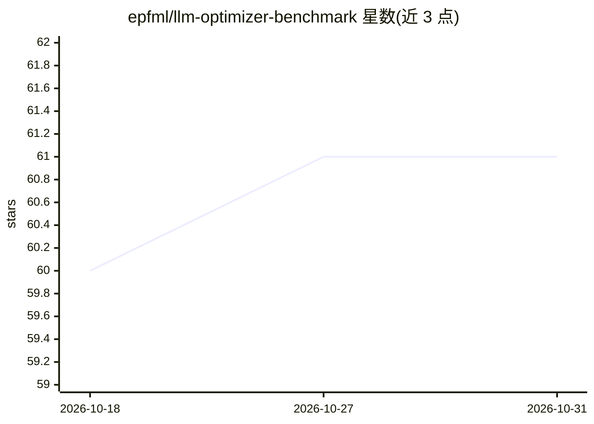

# epfml/llm-optimizer-benchmark

⭐ 61 · Python · Apache-2.0 · 推送 2026-05-03 · [GitHub](https://github.com/epfml/llm-optimizer-benchmark) · [官网](https://arxiv.org/abs/2509.01440) · 组织维护

**LLM 预训练优化器基准评测代码库（附论文）**

EPFL 团队发布的 LLM 预训练优化器评测代码库，基于 nanoGPT 扩展的 llm-baselines 框架。在标准化预训练场景下系统比较 AdamW、Lion、Sophia、SOAP、Muon 等优化器，变化模型规模（124M-720M 稠密、520M MoE）、批大小与训练时长，并提供下游评测（hellaswag、arc_challenge、gsm8k）。支持 conda 环境安装、WandB 日志、多 GPU 数据并行（torchrun/nccl），也支持 CPU 上以 Shakespeare 数据集本地试跑。可扩展自定义模型架构与优化器。

## 筛选速览

| 维度 | 判定 | 备注 |
|---|---|---|
| AI 角色 | `ai-ecosystem` | LLM/agent 周边工具 |
| 许可风险 | `permissive` | Apache-2.0 |
| 部署形态 | `library` | 以包/库形式分发 |
| 模型依赖 | — | README 未给出锁定关系 |
| 硬件要求 | — | 无带数字的原话,不猜 |
| 安装摩擦 | `low` | 无编译、无系统依赖或容器化 |
| 成熟度 | — | 结构信号不足 |

## 能力要点

- 标准化场景下系统评测多种 LLM 预训练优化器（124M-720M 稠密模型与 520M MoE）
- 提供 124M/210M/720M/520M 模型的完整复现脚本与 WandB 日志支持
- 下游性能评测（hellaswag、arc_challenge、gsm8k 等）
- 支持多 GPU 数据并行训练与 CPU 本地小规模实验，可扩展自定义架构与优化器

## 适用场景

- 复现论文中的优化器基准评测结果
- 为自己的 LLM 预训练任务选择优化器参考评测结论
- 在其框架上添加自定义模型架构或优化器做研究

## 场景标签

`模型评测` `模型训练` · 领域:评测与运维

## 证据(README 行号)

> L1: # Codebase: "Benchmarking Optimizers for Large Language Model Pretraining"
> L15: > The recent development of Large Language Models (LLMs) has been accompanied by an effervescence of novel ideas an
> L43: We present scripts for reproducing our benchmarking results for 124M, 210M, 720M dense Llama-based models, and 520M

## 星数曲线

2026-10-18 60 → 2026-10-31 61（+1）

---
*卡片 v1 · prompt 1.4 · 生成 2026-10-24 · 置信度 high · 依据 README sha `2274b04eab23` · [字段定义](../../DATASET.md)*
