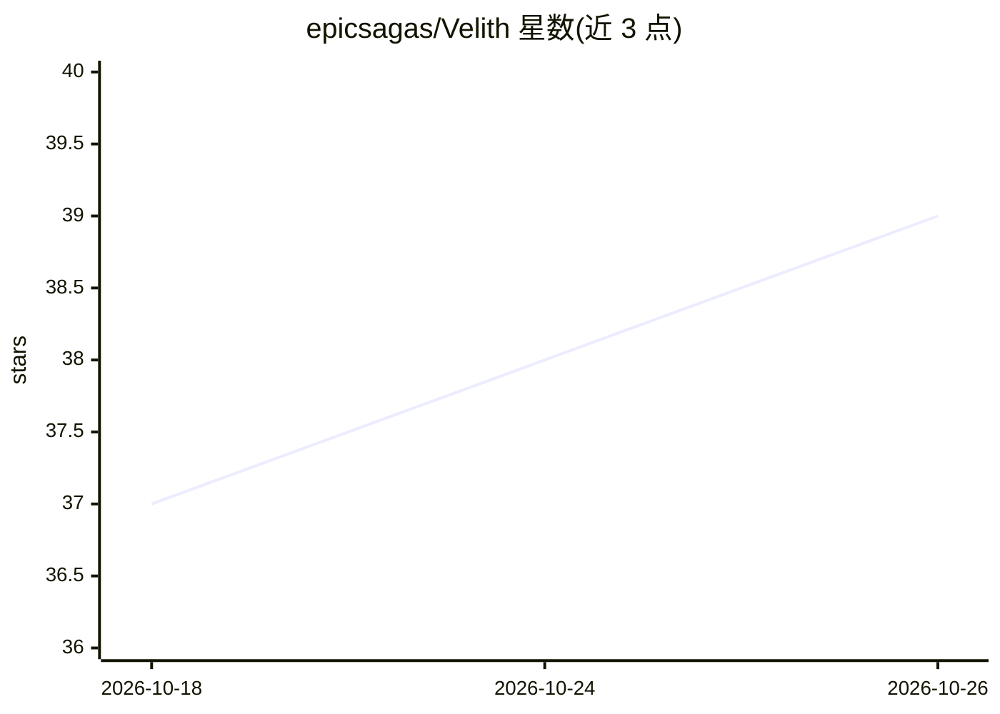

# epicsagas/Velith

⭐ 39 · JavaScript · Apache-2.0 · 推送 2026-09-30 · [GitHub](https://github.com/epicsagas/Velith) · [官网](https://epicsagas.github.io/Velith/) · 个人维护 · 中文 README

**面向写作者的 6 阶段 AI 出书流水线（Claude Code 插件），产出 EPUB/PDF**

以 Claude Code / Codex CLI / Grok Build 等编码代理为宿主的图书写作插件：用 18 个技能与 12 个子代理组成 6 阶段流水线（引导→构思→大纲→起草→编辑→出版），起草前锁定语态，逐章全稿上下文写作并批评-修订，fact-checker 维护声明台账，beta-reader 模拟读者给出发布门禁；配视觉系统（美术圣经、代码渲染图表、视觉 QA），经 Pandoc 输出 EPUB/PDF/MOBI 等。带 Node CLI 与 Svelte 仪表盘，限制是需宿主代理 CLI 与 Pandoc 等外部依赖。

## 筛选速览

| 维度 | 判定 | 备注 |
|---|---|---|
| AI 角色 | `ai-native` | 本体是模型或模型工具 |
| 许可风险 | `permissive` | Apache-2.0 |
| 部署形态 | `library` | 以包/库形式分发 |
| 模型依赖 | locked-api |  |
| 硬件要求 | — | 无带数字的原话,不猜 |
| 安装摩擦 | `low` | 无编译、无系统依赖或容器化 |
| 成熟度 | — | 结构信号不足 |

## 能力要点

- 6 阶段流水线（Onboarding→Publishing），带作者检查点
- 12 个专职子代理：写作、连续性、事实核查、风格医生、试读读者、美术等
- 7 阶段编辑流与五轴质量门禁（各轴≥7 方可发布）
- EPUB/PDF/MOBI/TXT/Markdown 输出，Pandoc + 可选 Calibre、epubcheck

## 适用场景

- 用 AI 代理走完整流程写一本小说或技术书并导出 EPUB/PDF
- 对已有书稿做多阶段编辑与事实核查
- 统一全书插画与封面风格并生成图像模型提示词

## 场景标签

`AI 写作` · 领域:内容生成

## 证据(README 行号)

> L23: **Books to the human-quality bar.** A six-phase pipeline that takes a book from a blank page to a publishable EPUB 
> L25: `Phase 0: Onboarding → Phase 1: Ideation → Phase 2: Outlining → Phase 3: Drafting → Phase 4: Editing → Phase 5: Pub
> L53: |🤖|12 specialized agents|Architect, scene planner, writer, continuity, fact-checker, style doctor, beta reader, art

## 星数曲线

2026-10-18 37 → 2026-10-26 39（+2）

---
*卡片 v1 · prompt 1.4 · 生成 2026-10-25 · 置信度 high · 依据 README sha `d775a0cad909` · [字段定义](../../DATASET.md)*
