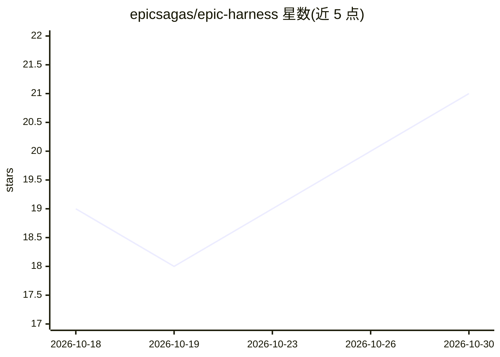

# epicsagas/epic-harness

⭐ 21 · Rust · Apache-2.0 · 推送 2026-10-29 · [GitHub](https://github.com/epicsagas/epic-harness) · [官网](https://epicsagas.github.io/epic-harness/) · 组织维护 · 中文 README

**自我进化的 Claude Code 插件：3 命令+25 技能+自主 spec-to-PR 流水线**

以 Rust 二进制与插件形式分发的 AI 编码 agent 外壳：将 30+ 命令整合为 /orbit、/team、/evolve 三个命令，配合 25 个按上下文自动触发的技能（TDD、调试、安全审计、简化等）。核心机制是 evolve 环：会话结束时分析工具调用失败模式（9 类错误分类、4 种模式检测），生成针对性技能并在下次会话加载，技能效果用 holdout A/B 对比衡量。附带自动启动的 Web 仪表盘与 harness-mem MCP 服务器，支持 Claude Code、Codex CLI、agy 安装。默认开启可关闭的匿名遥测。

## 筛选速览

| 维度 | 判定 | 备注 |
|---|---|---|
| AI 角色 | `ai-ecosystem` | LLM/agent 周边工具 |
| 许可风险 | `permissive` | Apache-2.0 |
| 部署形态 | `library` | 以包/库形式分发 |
| 模型依赖 | — | README 未给出锁定关系 |
| 硬件要求 | — | 无带数字的原话,不猜 |
| 安装摩擦 | `low` | 无编译、无系统依赖或容器化 |
| 成熟度 | — | 结构信号不足 |

## 能力要点

- /orbit 单命令自主流水线：spec→go→check→ship→PR→evolve
- 25 个技能按上下文自动触发（tdd/debug/secure/threat-model 等）
- evolve 环从失败模式生成新技能，附 holdout A/B 效果对比
- 10 屏实时 Web 仪表盘（默认 localhost:7700，可关闭）

## 适用场景

- 用一条命令完成从需求澄清到 PR 与 CI 的端到端交付
- 让编码 agent 从每次会话的失败中自动沉淀新技能
- 在编码过程中自动执行 TDD、安全审计与代码审查

## 场景标签

`编码 Agent` `代码审查` · 领域:编码与开发

## 证据(README 行号)

> L20: A Claude Code plugin that **consolidates 30+ commands into 3 commands + 25 auto-trigger skills**, and **evolves new
> L76: epic-harness ships as a **plugin** — skills, hooks, and the `harness-mem` MCP server are loaded directly from the p

## 星数曲线

2026-10-18 19 → 2026-10-30 21（+2）

---
*卡片 v1 · prompt 1.4 · 生成 2026-10-28 · 置信度 high · 依据 README sha `526043a5fe1f` · [字段定义](../../DATASET.md)*
