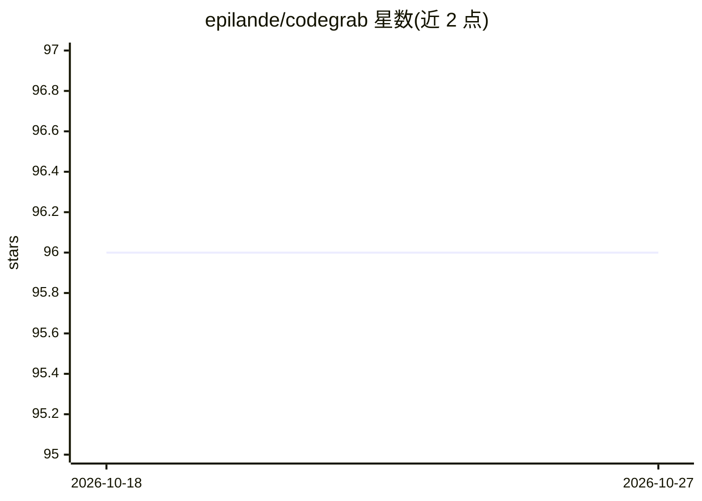

# epilande/codegrab

⭐ 96 · Go · MIT · 推送 2026-01-02 · [GitHub](https://github.com/epilande/codegrab) · 个人维护

**给开发者的 CLI 工具：交互式选取代码并打包为 LLM 就绪文件**

基于 Go 与 Bubbletea 的终端工具，供需要向 LLM 分享代码上下文的开发者使用。提供 TUI 交互模式（vim 风格键位、模糊搜索、文件树选择）与非交互 CLI 模式，将选中文件生成为 Markdown/Plain Text/XML 单文件输出并可复制到剪贴板。机制上：尊重 .gitignore 与 glob 过滤、基于 tree-sitter 的 Go/JS-TS/Python 依赖自动解析、gitleaks 密钥检测与脱敏、token 数估算，并支持传入 Git URL 直接浅克隆分析远程仓库。限制：依赖解析仅支持三种语言。

## 筛选速览

| 维度 | 判定 | 备注 |
|---|---|---|
| AI 角色 | `ai-ecosystem` | LLM/agent 周边工具 |
| 许可风险 | `permissive` | MIT |
| 部署形态 | `library` | 以包/库形式分发 |
| 模型依赖 | — | README 未给出锁定关系 |
| 硬件要求 | — | 无带数字的原话,不猜 |
| 安装摩擦 | `low` | 无编译、无系统依赖或容器化 |
| 成熟度 | — | 结构信号不足 |

## 能力要点

- TUI 交互选择 + 非交互 CLI 双模式，输出 Markdown/Text/XML
- tree-sitter 依赖解析（Go、JS/TS、Python），可控制递归深度
- gitleaks 密钥检测与 [REDACTED_RuleID] 自动脱敏（默认开启）
- 传入 Git URL 浅克隆分析远程仓库（GitHub/GitLab/Bitbucket/SSH/HTTPS）

## 适用场景

- 向 LLM/AI 助手分享项目代码上下文前打包选中文件
- 通过依赖解析生成包含完整 import 链的代码片段
- 分享项目结构树给 LLM 而不暴露文件内容

## 场景标签

 · 领域:开发者工具/LLM 上下文

## 证据(README 行号)

> L3:  An interactive CLI tool for selecting and bundling code into a single, LLM-ready output file.
> L10: manually copying files or creating code snippets is tedious. CodeGrab streamlines this process by
> L13: to your clipboard, ready for LLM processing.

## 星数曲线

2026-10-18 96 → 2026-10-27 96（+0）

---
*卡片 v1 · prompt 1.4 · 生成 2026-10-23 · 置信度 high · 依据 README sha `92b00198cc0a` · [字段定义](../../DATASET.md)*
