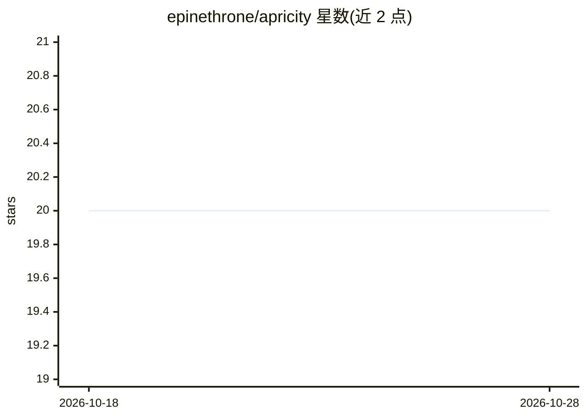

# epinethrone/apricity

⭐ 20 · CSS · MIT · 推送 2026-08-18 · [GitHub](https://github.com/epinethrone/apricity) · 个人维护

**本地 Web 前端：浏览、编辑与治理 AI agent 的 MemPalace 记忆库**

面向已安装 MemPalace 个人记忆系统的用户，提供浏览器端管理界面：三栏浏览、全文搜索与过滤、WYSIWYG 内联编辑、草稿收件箱、删除快照与恢复、知识图谱三元组查看与力导向可视化、Tunnels 跨房间链接管理，以及展示 MemPalace MCP 工具的面板。纯 Python 标准库实现，零第三方运行时依赖，绑定 127.0.0.1，写入经官方 mempalace 包，带 PBKDF2 会话认证。限制：需同机已安装并初始化 MemPalace，自身不包含记忆系统。

## 筛选速览

| 维度 | 判定 | 备注 |
|---|---|---|
| AI 角色 | `ai-ecosystem` | LLM/agent 周边工具 |
| 许可风险 | `permissive` | MIT |
| 部署形态 | `library` | 以包/库形式分发 |
| 模型依赖 | — | README 未给出锁定关系 |
| 硬件要求 | — | 无带数字的原话,不猜 |
| 安装摩擦 | `low` | 无编译、无系统依赖或容器化 |
| 成熟度 | — | 结构信号不足 |

## 能力要点

- 三栏浏览 + ⌘K 搜索 + 键盘驱动的编辑与浏览模式
- 所有删除操作快照化，Recently deleted 一键恢复
- 知识图谱三元组管理与力导向图可视化
- 纯标准库服务端 + 原生 HTML/CSS/JS，无构建步骤与运行时依赖

## 适用场景

- 不想写 SQL 或困在 MCP shell 里，可视化浏览数百条 agent 记忆
- 编辑、移动、整理 agent 写入 MemPalace 的记忆与元数据
- 查看并维护 agent 的知识图谱三元组与跨房间链接
- 恢复误删的记忆并跟踪各模型新写入/更新的内容

## 场景标签

`Agent 记忆` `知识图谱` · 领域:Agent 开发

## 证据(README 行号)

> L20: MemPalace gives your AI assistant a structured, durable memory — wings, rooms, drawers, and a knowledge graph, all 
> L22: It is *not* a memory system of its own — it reads and writes an existing MemPalace install on the same machine, thr
> L85: - **Tools panel** — a power-user sheet that surfaces MemPalace's MCP tools: knowledge-graph query + timeline, tunne

## 星数曲线

2026-10-18 20 → 2026-10-28 20（+0）

---
*卡片 v1 · prompt 1.4 · 生成 2026-10-28 · 置信度 high · 依据 README sha `e3b19f36e2fa` · [字段定义](../../DATASET.md)*
