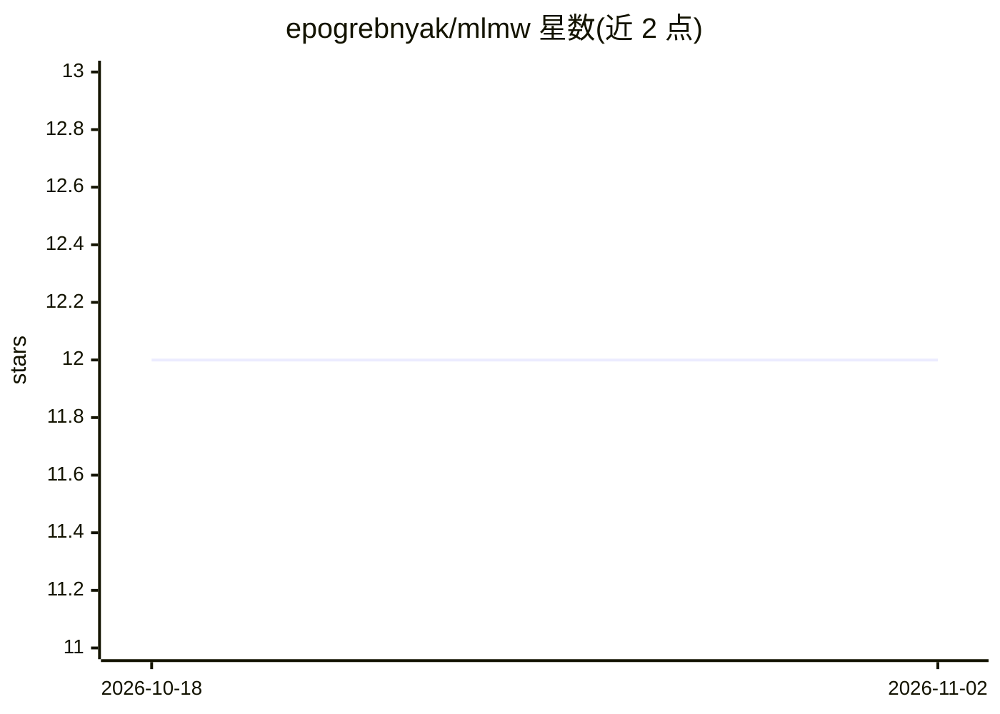

# epogrebnyak/mlmw

⭐ 12 · Python · 推送 2026-05-22 · [GitHub](https://github.com/epogrebnyak/mlmw) · [官网](https://trics.me) · 个人维护

**概率统计与机器学习自学指南（trics.me 站点源码）**

Machine Learning My Way (MLMW) 是 trics.me 网站的源码仓库，内容为概率、统计、计量经济学与机器学习的自学指南，聚合免费教材、公开综述文章与 Reddit 讨论选编。项目是 2018-2020 年运营的 Econometrics Navigator 网站的后继。网站用 mdbook 静态站点生成器构建，配合 just 命令运行器、prettier、typst、pandoc 等工具链，通过 GitHub Pages 部署。提供邮件列表、subreddit 与 Telegram 群组供跟踪更新。

## 筛选速览

| 维度 | 判定 | 备注 |
|---|---|---|
| AI 角色 | `ai-knowledge` | 知识聚合/清单类 |
| 许可风险 | `none` | — |
| 部署形态 | `None` |  |
| 模型依赖 | — | README 未给出锁定关系 |
| 硬件要求 | — | 无带数字的原话,不猜 |
| 安装摩擦 | `low` | 无编译、无系统依赖或容器化 |
| 成熟度 | — | 结构信号不足 |

## 能力要点

- 聚合免费教材、公开综述与 Reddit 讨论的学习指南
- 覆盖概率、统计、计量经济学与机器学习四个主题
- 基于 mdbook + GitHub Pages 的静态站点，附 typst/pandoc 文档工具链

## 适用场景

- 自学概率统计与机器学习时查找免费教材资源
- 按主题浏览计量经济学与机器学习的综述文章
- 通过邮件列表和社群跟踪指南更新

## 场景标签

`教程课程` `精选清单` · 领域:学习与行业

## 证据(README 行号)

> L3: This is the source repo for trics.me,
> L4: a machine learning study guide with free textbooks, open review articles,

## 星数曲线

2026-10-18 12 → 2026-11-02 12（+0）

---
*卡片 v1 · prompt 1.4 · 生成 2026-11-01 · 置信度 high · 依据 README sha `2c6dbc70b01f` · [字段定义](../../DATASET.md)*
