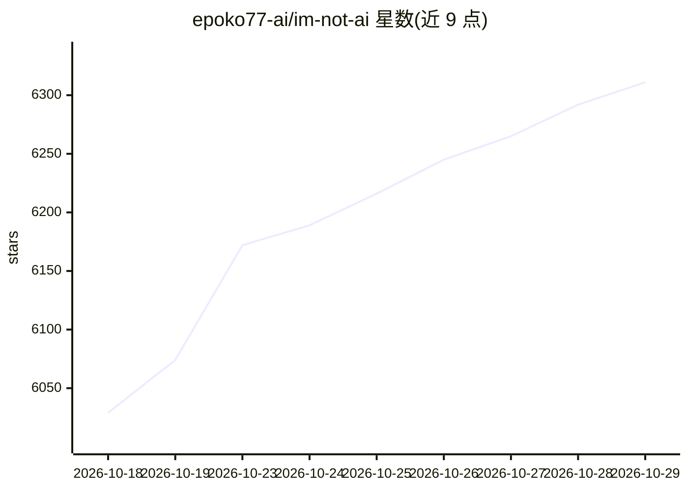

# epoko77-ai/im-not-ai

⭐ 6,311 · Python · MIT · 推送 2026-10-12 · [GitHub](https://github.com/epoko77-ai/im-not-ai) · [官网](https://imnotai.kr) · 组织维护

**将 AI 生成的韩文改写为自然韩文的 Claude/CLI 技能**

面向韩文写作者的 AI 文本人性化技能（v2.3.2），以 Claude Code、GitHub Copilot CLI、Codex CLI、Gemini CLI 插件/技能形式分发，也提供 install.sh 脚本与 git clone 安装。核心机制：按 10 大类 × 85 个子模式检测韩文 AI 痕迹（翻译腔、机械并列、AI 惯用语、被动滥用等），以 S1/S2/S3 分级，用定量预打分产出 route_hint，将文本分流到 light（1 次 LLM 调用）/standard（2 次）/heavy（3+ 次，含分块与 finalize 验证）三条路径；约束包括事实数字 100% 保留、变更率超 50% 强制中止。Copilot 与 Gemini 仅支持单调用 light 路径。产出物写入 _workspace 目录（指标、诊断、改写稿、验证报告）。

## 筛选速览

| 维度 | 判定 | 备注 |
|---|---|---|
| AI 角色 | `ai-native` | 本体是模型或模型工具 |
| 许可风险 | `permissive` | MIT |
| 部署形态 | `None` |  |
| 模型依赖 | — | README 未给出锁定关系 |
| 硬件要求 | — | 无带数字的原话,不猜 |
| 安装摩擦 | `low` | 无编译、无系统依赖或容器化 |
| 成熟度 | — | 结构信号不足 |

## 能力要点

- 10 大类 × 85 个韩文 AI 痕迹子模式，S1/S2/S3 严重度分级
- route_hint 三路径（light/standard/heavy）按文本状态决定 LLM 调用次数
- heavy 路径含分块并行改写、重组校验与 15 项语义保留判定
- 变更率超 30% 警告、超 50% 强制中止的过改写防护

## 适用场景

- 把 ChatGPT/Claude/Gemini 写出的韩文初稿改成自然韩文
- 去除韩文文本中的翻译腔与 AI 惯用表达
- 长篇（1.5 万字以上）韩文 AI 稿件的分块改写与验证

## 场景标签

`AI 写作` · 领域:内容生成

## 证据(README 行号)

> L7: AI(ChatGPT · Claude · Gemini 등)가 쓴 한글 글을 **사실 · 주장 · 수치는 바꾸지 않고** 문체 · 리듬 · 표현만 자연스러운 한국어로 되돌리는 CLI 스킬입니다.
> L9: 번역투, 과도한 영어 인용, 기계적 병렬 ("첫째 · 둘째 · 셋째"), "결론적으로 / 시사하는 바가 크다" 같은 AI 특유 관용구, 피동태 남용, 문두 접속사 남발, 이모지·불릿 남용 등 **10대 카테고
> L79: 입력을 shim(`prepare_monolith_input.py`)이 먼저 정량 채점하고, 그 점수로 **`route_hint`(light | standard | heavy)** 를 결정적으로 산출합니다. 

## 星数曲线

2026-10-18 6,029 → 2026-10-29 6,311（+282）

---
*卡片 v1 · prompt 1.4 · 生成 2026-10-20 · 置信度 high · 依据 README sha `e52a9fa5e606` · [字段定义](../../DATASET.md)*
