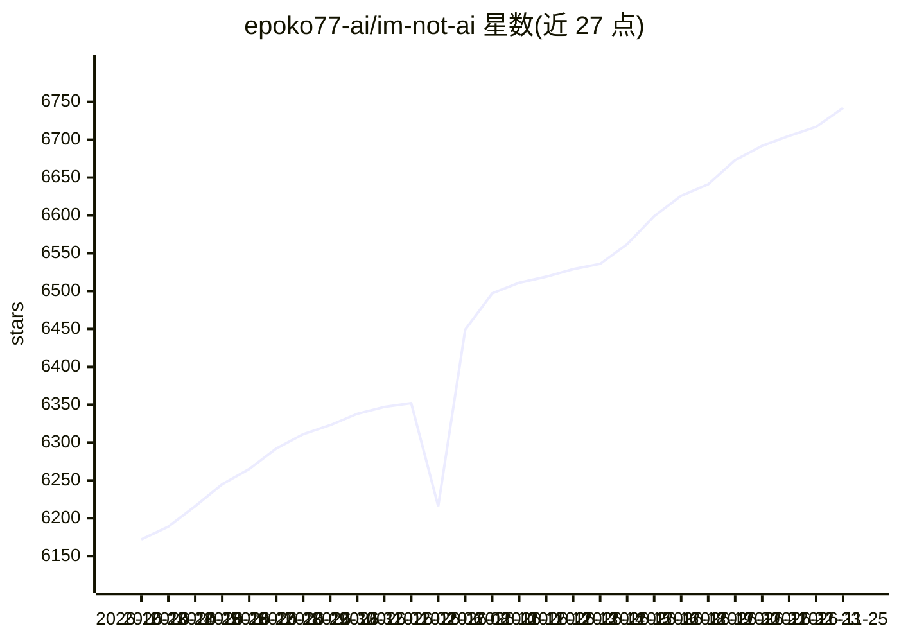

# epoko77-ai/im-not-ai

⭐ 6,742 · Python · MIT · 推送 2026-11-23 · [GitHub](https://github.com/epoko77-ai/im-not-ai) · [官网](https://imnotai.kr) · 个人维护

**给韩语写作者：去除 AI 生成韩文痕迹的 Claude 技能改写工具**

面向韩语使用的 CLI 技能：检测 AI（ChatGPT/Claude/Gemini 等）生成韩文中的翻译腔、机械排比、惯用语等 10 大类 85 种子模式，按 S1-S3 分级后在保留事实、主张与数值的前提下做文体改写。按文本状态以 route_hint 决定 light/standard/heavy 三条调用路径（1/2/3+ 次 LLM 调用），设有改动率 30% 警告、50% 强制中止的过度改写门槛。支持 Claude Code、GitHub Copilot CLI、Codex CLI、Gemini CLI 四个官方运行时，Gemini 扩展使用独立的 47 模式规则本。

## 筛选速览

| 维度 | 判定 | 备注 |
|---|---|---|
| AI 角色 | `ai-native` | 本体是模型或模型工具 |
| 许可风险 | `permissive` | MIT |
| 部署形态 | `None` |  |
| 模型依赖 | locked-api |  |
| 硬件要求 | — | 无带数字的原话,不猜 |
| 安装摩擦 | `low` | 无编译、无系统依赖或容器化 |
| 成熟度 | — | 结构信号不足 |

## 能力要点

- 10 大类 × 85 种 AI 痕迹子模式检测与 span 级改写
- route_hint 三路径（light 1 调 / standard 2 调 / heavy 3+ 调）决定调用次数
- 四条铁律：意义不变、基于检测、体裁保持、禁止过度改写（30% 警告 / 50% 中止）
- 官方支持 Claude Code / Copilot CLI / Codex / Gemini CLI 四运行时

## 适用场景

- 改写 ChatGPT/Claude 生成的韩文初稿，去除翻译腔
- 发布前用 /humanize-scan 快速评估文章是否值得全文改写
- 韩语专栏、报告等体裁文本的风格自然化处理

## 场景标签

`AI 写作` · 领域:内容生成

## 证据(README 行号)

> L7: AI(ChatGPT · Claude · Gemini 등)가 쓴 한글 글을 **사실 · 주장 · 수치는 바꾸지 않고** 문체 · 리듬 · 표현만 자연스러운 한국어로 되돌리는 CLI 스킬입니다.
> L70: 이 도구는 그 한글 고유 패턴을 SSOT로 정리하고, 글의 상태에 맞는 세 경로(light 1콜 / standard 2콜 / heavy 3+콜) 중 하나로 윤문합니다. 잘 쓴 글일수록 콜 수가 줄어 빠르고 
> L15: > **Claude Code**, **GitHub Copilot CLI**, **OpenAI Codex CLI**, **Gemini CLI**를 지원합니다. 전체 가이드: `INSTALL.md`

## 星数曲线

2026-10-23 6,172 → 2026-11-25 6,742（+570）

---
*卡片 v1 · prompt 1.4 · 生成 2026-11-24 · 置信度 high · 依据 README sha `ec74abe57bb7` · [字段定义](../../DATASET.md)*
