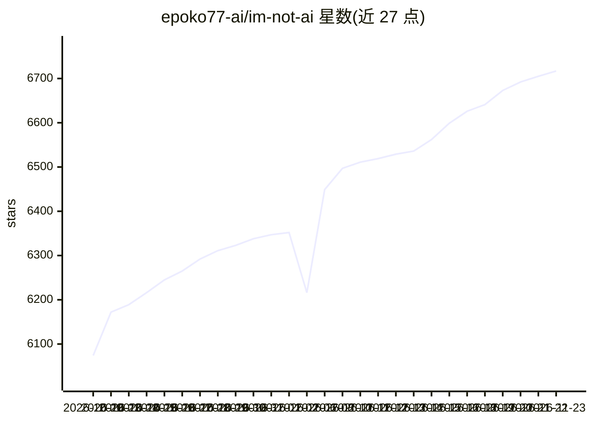

# epoko77-ai/im-not-ai

⭐ 6,717 · Python · MIT · 推送 2026-11-17 · [GitHub](https://github.com/epoko77-ai/im-not-ai) · [官网](https://imnotai.kr) · 个人维护

**去除韩文 AI 痕迹的 Claude 技能：检测并改写 AI 文风**

面向韩语文体的 CLI 技能：不改事实、主张与数字，仅从文体层面处理 AI 生成文本，覆盖翻译腔、机械排比、AI 惯用语等 10 大类 85 个子模式并按 S1-S3 分级。运行于 Claude Code、Codex CLI、GitHub Copilot CLI、Gemini CLI 四个宿主；按定量预评分给出 light/standard/heavy 三条调用路径（1/2/3+ 次 LLM 调用），带语义保真 15 项校验与超限强制中断。旧 strict 五阶段管线组件在 v2.1 退役。

## 筛选速览

| 维度 | 判定 | 备注 |
|---|---|---|
| AI 角色 | `ai-native` | 本体是模型或模型工具 |
| 许可风险 | `permissive` | MIT |
| 部署形态 | `None` |  |
| 模型依赖 | — | README 未给出锁定关系 |
| 硬件要求 | — | 无带数字的原话,不猜 |
| 安装摩擦 | `low` | 无编译、无系统依赖或容器化 |
| 成熟度 | — | 结构信号不足 |

## 能力要点

- 10 大类 × 85 个韩文 AI 痕迹子模式分级检测（S1/S2/S3）
- route_hint 三路径：light 1 调用 / standard 2 / heavy 3+，按文本状态降低调用量
- 四条铁律：语义不变、仅改已检测 span、体裁保留、改写率超 30% 警告 50% 中断
- v2.4 词汇层：115 个翻译体词汇按上下文修正（非批量替换）

## 适用场景

- 把 ChatGPT/Claude 生成的韩文草稿改得更像人写的
- 处理韩文技术文章中的翻译腔表达
- 发布前快速扫描一篇文本值不值得全文改写（/humanize-scan）

## 场景标签

`AI 写作` · 领域:内容生成

## 证据(README 行号)

> L7: AI(ChatGPT · Claude · Gemini 등)가 쓴 한글 글을 **사실 · 주장 · 수치는 바꾸지 않고** 문체 · 리듬 · 표현만 자연스러운 한국어로 되돌리는 CLI 스킬입니다.
> L70: 이 도구는 그 한글 고유 패턴을 SSOT로 정리하고, 글의 상태에 맞는 세 경로(light 1콜 / standard 2콜 / heavy 3+콜) 중 하나로 윤문합니다. 잘 쓴 글일수록 콜 수가 줄어 빠르고 

## 星数曲线

2026-10-20 6,074 → 2026-11-23 6,717（+643）

---
*卡片 v1 · prompt 1.4 · 生成 2026-11-23 · 置信度 high · 依据 README sha `5883de2e26ec` · [字段定义](../../DATASET.md)*
