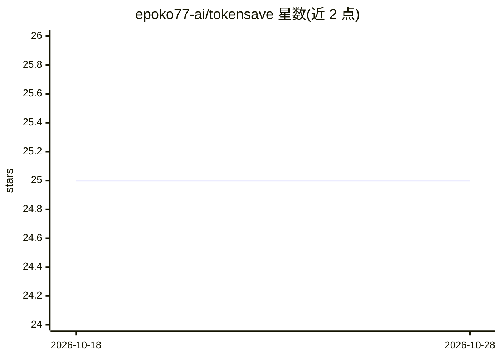

# epoko77-ai/tokensave

⭐ 25 · Python · MIT · 推送 2026-05-14 · [GitHub](https://github.com/epoko77-ai/tokensave) · [官网](https://github.com/epoko77-ai/tokensave) · 个人维护 · 中文 README

**Claude Code 多智能体 harness 的 token 成本 lint 工具**

面向 Claude Code 多智能体 harness 的成本审计元技能：由 10 类 ×31 子模式的分类学、静态审计脚本 audit.py（对 ~/.claude 应用 9 条规则）、LLM 调用 0 次的 model_selector.py 决策树、24 行任务→模型矩阵和团队构成矩阵组成。仅用 Python 标准库，无外部依赖，可部署为 Claude Code 技能自动触发。局限：检测基于 ~/.claude/agents 布局与 SKILL.md 约定，仅限 Claude Code（LangChain/CrewAI/AutoGen 需适配器，列于路线图）；成本基线为作者本人 N=1 目录；价格数据带时间戳；未测量质量退化风险。

## 筛选速览

| 维度 | 判定 | 备注 |
|---|---|---|
| AI 角色 | `ai-ecosystem` | LLM/agent 周边工具 |
| 许可风险 | `permissive` | MIT |
| 部署形态 | `library` | 以包/库形式分发 |
| 模型依赖 | — | README 未给出锁定关系 |
| 硬件要求 | — | 无带数字的原话,不猜 |
| 安装摩擦 | `low` | 无编译、无系统依赖或容器化 |
| 成熟度 | — | 结构信号不足 |

## 能力要点

- audit.py 静态审计 ~/.claude 全目录，约 5 秒，LLM 调用 0 次
- model_selector.py 自然语言任务描述→推荐模型+成本估算的 CLI 决策树
- 10 类 ×31 子模式分类学（taxonomy.md/json），每卡含检测方法与缓解措施
- 仅标准库，无 pip 依赖，Python 3.10+

## 适用场景

- 审计我的 Claude Code 多智能体 harness 在哪里泄漏 token 成本
- 按任务类型决定该用 Haiku/Sonnet/Opus 哪一档模型
- 作为 SKILL.md 写作或 harness 设计评审时的检查清单

## 场景标签

`LLM 可观测性` · 领域:评测与运维

## 证据(README 行号)

> L11: > **멀티에이전트 Claude Code 하네스를 위한 토큰 비용 lint 도구.**
> L29: `tokensave`은 (1) 분류학(10 카테고리 × 31 sub-patterns), (2) 정적 감사 스크립트 `audit.py`, (3) LLM 호출 0회 결정 트리 `model_selector.py`
> L57: |**Audit**|`audit.py` — `~/.claude` 전체에 9개 정적 룰 적용|약 5초, LLM 0회|

## 星数曲线

2026-10-18 25 → 2026-10-28 25（+0）

---
*卡片 v1 · prompt 1.4 · 生成 2026-10-27 · 置信度 mid · 依据 README sha `3268d7b659bc` · [字段定义](../../DATASET.md)*
