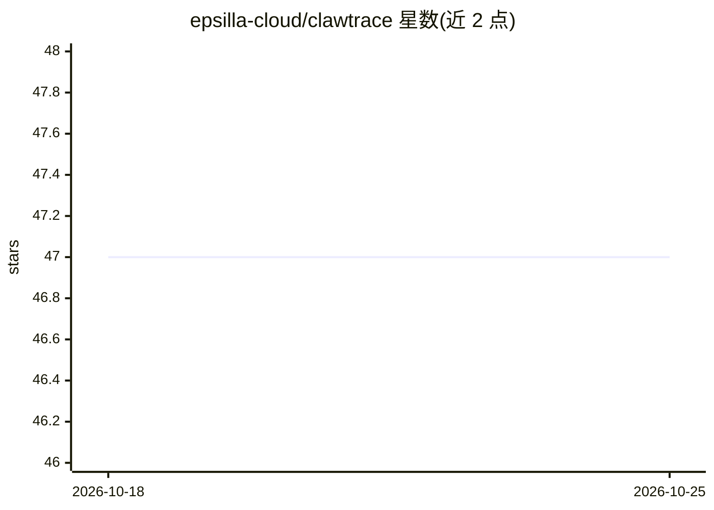

# epsilla-cloud/clawtrace

⭐ 47 · TypeScript · Apache-2.0 · 推送 2026-08-15 · [GitHub](https://github.com/epsilla-cloud/clawtrace) · [官网](https://www.clawtrace.ai/) · 组织维护

**OpenClaw agent 的成本感知追踪与技能蒸馏平台**

面向 LLM agent（OpenClaw）的可观测性插件：拦截 8 种 hook 记录每次 LLM 调用、工具调用与子 agent 生成，编译成约 1.5 kB 的 TraceCard YAML（含每步美元成本、token 数、冗余标记），并在 CostCraft 中以 preserve/prune/repair 三类补丁做技能蒸馏。提供执行树、调用图、甘特图三种视图，内置 AI 分析师 Tracy（Cypher 查询轨迹图）。云端服务部署于 Vercel/Docker+K8s，数据经 Databricks/Iceberg/PuppyGraph 流水线处理；定价覆盖 80+ 模型。有 arXiv 论文，Apache 2.0 许可。

## 筛选速览

| 维度 | 判定 | 备注 |
|---|---|---|
| AI 角色 | `ai-ecosystem` | LLM/agent 周边工具 |
| 许可风险 | `permissive` | Apache-2.0 |
| 部署形态 | `library` | 以包/库形式分发 |
| 模型依赖 | locked-api |  |
| 硬件要求 | — | 无带数字的原话,不猜 |
| 安装摩擦 | `low` | 无编译、无系统依赖或容器化 |
| 成熟度 | — | 结构信号不足 |

## 能力要点

- 每次 agent 运行记录为 span 树，展示逐步 token 用量、成本与重试
- TraceCard ~1.5 kB YAML 摘要 + CostCraft preserve/prune/repair 技能补丁
- Tracy AI 分析师：自然语言提问，实时 Cypher 查询轨迹图并生成图表
- /v1/evolve/ask 端点与 Self-Evolve 技能支持 agent 自查成本与失败模式

## 适用场景

- 排查 agent token 预算异常消耗与工具循环
- 按步骤审计 agent 运行的成本与 token 分布
- 从轨迹蒸馏可复用规则以改进 agent 技能

## 场景标签

`LLM 可观测性` · 领域:评测与运维

## 证据(README 行号)

> L22: Skill-distillation pipelines learn reusable rules from LLM agent trajectories, but they lack a key signal — **how m
> L124: 1. **Capture** — The plugin intercepts 8 OpenClaw hook types: `session_start`, `session_end`, `llm_input`, `llm_ou

## 星数曲线

2026-10-18 47 → 2026-10-25 47（+0）

---
*卡片 v1 · prompt 1.4 · 生成 2026-10-25 · 置信度 mid · 依据 README sha `e36f0850781d` · [字段定义](../../DATASET.md)*
