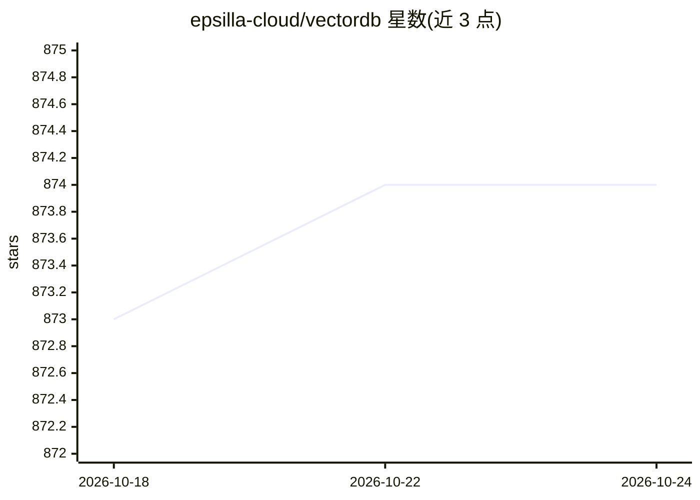

# epsilla-cloud/vectordb

⭐ 874 · C++ · Apache-2.0 · 推送 2026-10-04 · [GitHub](https://github.com/epsilla-cloud/vectordb) · [官网](https://epsilla.com) · 组织维护

**开源向量数据库，面向 LLM 应用的相似度检索与存储**

Epsilla 是一个用 C++ 实现的开源向量数据库，核心采用并行图遍历技术做向量索引，提供 database/table/field 概念的完整数据库管理系统。功能包括生产规模相似度搜索、元数据过滤、稠密与稀疏向量混合搜索、内置 embedding 支持与云端原生架构。面向 LLM 应用开发者，提供 Python/JavaScript/Ruby 客户端与 REST API，可经 Docker 运行，也可实验性地编译为 Python 库使用；另有托管的 Epsilla Cloud 服务。

## 筛选速览

| 维度 | 判定 | 备注 |
|---|---|---|
| AI 角色 | `ai-ecosystem` | LLM/agent 周边工具 |
| 许可风险 | `permissive` | Apache-2.0 |
| 部署形态 | `self-host` | docker 或自建部署 |
| 模型依赖 | — | README 未给出锁定关系 |
| 硬件要求 | — | 无带数字的原话,不猜 |
| 安装摩擦 | `low` | 无编译、无系统依赖或容器化 |
| 成熟度 | `idea` | |

## 能力要点

- C++ 核心采用并行图遍历向量索引
- 元数据过滤与稠密/稀疏向量混合搜索
- 内置 embedding 支持与云端原生架构（存算分离、多租户）
- Python/JavaScript/Ruby 客户端与 REST API

## 适用场景

- 为 LLM/RAG 应用存储和检索 embedding 向量
- 需要元数据过滤与混合检索的生产级相似度搜索
- 以熟悉的数据库/表/字段模型管理向量数据

## 场景标签

`向量数据库` · 领域:知识与检索

## 证据(README 行号)

> L14: Epsilla is an open-source vector database. Our focus is on ensuring scalability, high performance, and cost-effecti
> L54: Epsilla's core is written in C++ and leverages the advanced academic parallel graph traversal techniques for vector

## 星数曲线

2026-10-18 873 → 2026-10-24 874（+1）

---
*卡片 v1 · prompt 1.4 · 生成 2026-10-21 · 置信度 high · 依据 README sha `1755bf6897cf` · [字段定义](../../DATASET.md)*
