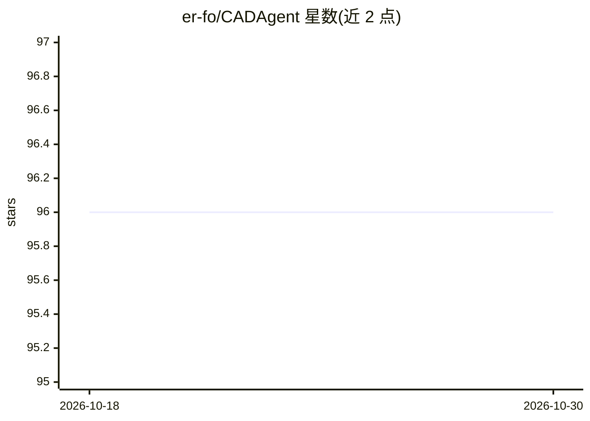

# er-fo/CADAgent

⭐ 96 · Python · MIT · 推送 2026-09-06 · [GitHub](https://github.com/er-fo/CADAgent) · [官网](https://cadagent.co) · 个人维护

**面向 Fusion 360 的 AI 建模助手：自然语言生成与修改 CAD 模型**

由两部分组成：运行在 Autodesk Fusion 360 内的插件，以及可自托管的 FastAPI 后端。用户用自然语言描述需求，后端将请求转换为工具调用，插件通过 WebSocket 接收并在 Fusion 中执行 CAD 操作。提供 Windows/macOS 插件发布包，后端需自行运行（官方托管后端已关闭，自建为支持路径），认证与配额依赖 Supabase，附 AWS 部署参考模板。

## 筛选速览

| 维度 | 判定 | 备注 |
|---|---|---|
| AI 角色 | `ai-native` | 本体是模型或模型工具 |
| 许可风险 | `permissive` | MIT |
| 部署形态 | `library` | 以包/库形式分发 |
| 模型依赖 | — | README 未给出锁定关系 |
| 硬件要求 | — | 无带数字的原话,不猜 |
| 安装摩擦 | `low` | 无编译、无系统依赖或容器化 |
| 成熟度 | — | 结构信号不足 |

## 能力要点

- Fusion 360 插件通过 WebSocket 与自托管 FastAPI 后端通信
- 自然语言请求转换为插件执行的 CAD 工具调用
- Windows/macOS 均有插件发布包
- 含 pytest 测试与生产部署文档（systemd/nginx/CodeDeploy）

## 适用场景

- 用自然语言在 Fusion 360 中创建和修改 CAD 模型
- 本地或自有服务器自托管后端保持数据可控
- 按需接入自己的后端地址使用插件

## 场景标签

 · 领域:CAD/设计工具

## 证据(README 行号)

> L3: AI-powered CAD modeling assistant for Autodesk Fusion 360. Describe what you want in plain English, and CADAgent bui
> L10: |Backend|`apps/backend/`|FastAPI service that turns natural-language requests into tool calls the add-in executes. 
> L35: Restart Fusion 360, then run it from **Tools > Add-Ins > CADAgent > Run**. Type a request such as "Create a 5cm cub

## 星数曲线

2026-10-18 96 → 2026-10-30 96（+0）

---
*卡片 v1 · prompt 1.4 · 生成 2026-10-23 · 置信度 high · 依据 README sha `b323e8dcc041` · [字段定义](../../DATASET.md)*
