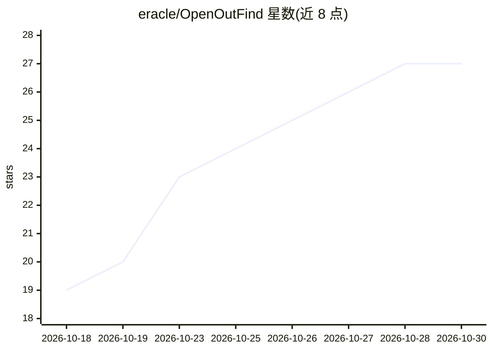

# eracle/OpenOutFind

⭐ 27 · Python · GPL-3.0 · 推送 2026-10-29 · [GitHub](https://github.com/eracle/OpenOutFind) · [官网](https://openoutreach.app) · 个人维护

**自托管 CLI：用 LLM 从持牌数据源筛选 B2B 潜客并输出理由**

面向 B2B 销售的开源潜客筛选工具（GPLv3，自托管 CLI）。用户给出产品描述与目标市场，LLM 生成搜索关键词，在持牌数据源（BetterContact Lead Finder）中做发现检索；LLM 逐个判定候选是否符合 ICP 并写下理由，高斯过程模型根据判定结果选择下一批候选。输出为可导入 Instantly/Smartlead 等冷邮件工具的 CSV，含 reason 字段。不发送邮件、无浏览器抓取。需自备 LLM API key 与 BetterContact key，邮件富化按验证命中付费（每条一积分）。

## 筛选速览

| 维度 | 判定 | 备注 |
|---|---|---|
| AI 角色 | `ai-native` | 本体是模型或模型工具 |
| 许可风险 | `viral` | GPL-3.0 |
| 部署形态 | `library` | 以包/库形式分发 |
| 模型依赖 | — | README 未给出锁定关系 |
| 硬件要求 | — | 无带数字的原话,不猜 |
| 安装摩擦 | `low` | 无编译、无系统依赖或容器化 |
| 成熟度 | `idea` | |

## 能力要点

- LLM 按 ICP 逐个判定候选并输出书面理由
- 高斯过程主动学习循环选择下一批待判定候选（作者声明为实验性，未证明优于随机）
- CSV 输出列名适配 Instantly/Smartlead 导入，无需列映射
- 发现检索免费，付费邮箱查找以模型置信度作为消费门槛

## 适用场景

- 我输入产品描述就能得到带理由的合格潜客清单
- 把带 reason 列的 CSV 直接导入我现有的冷邮件工具
- 仅用免费积分先做发现与资格判定，不购买邮箱

## 场景标签

 · 领域:销售/GTM 工具

## 证据(README 行号)

> L20: OpenOutFind is a **self-hosted, open-source lead finder that qualifies for you**. You describe your product and you
> L39: 4. **An LLM qualifies each candidate** against your ICP and **writes down why**. A model of your ICP (Gaussian Proc

## 星数曲线

2026-10-18 19 → 2026-10-30 27（+8）

---
*卡片 v1 · prompt 1.4 · 生成 2026-10-27 · 置信度 high · 依据 README sha `42e2591565fd` · [字段定义](../../DATASET.md)*
