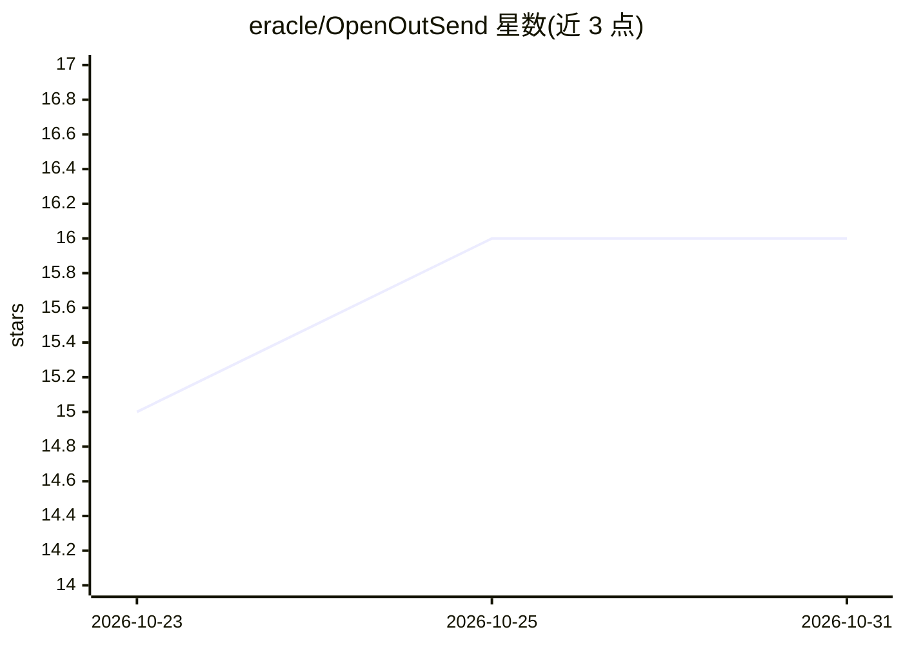

# eracle/OpenOutSend

⭐ 16 · Python · MIT · 推送 2026-10-30 · [GitHub](https://github.com/eracle/OpenOutSend) · [官网](https://openoutreach.app) · 个人维护

**面向 B2B 冷邮件外联的发送端 CLI：接收线索并按节奏发送**

OpenOutreach 双件中的发送半部：通过管道读取 OpenOutFind 产出的 JSON Lines 线索，存入自带 SQLite/Postgres 数据库，再由独立命令 outsend send 读取邮箱、回复线索、按间隔时钟/每日上限/发送窗口发送 AI 撰写的冷邮件与跟进序列。默认由 AI_MODEL 基于完整对话历史生成邮件，也支持 --agent-draft 将起草交回调用方 LLM 或用 .email.j2 免模型步骤。所有邮件强制附加一行 Sent with OpenOutreach 且不可关闭；反垃圾邮件合规责任在使用者。面向做外联自动化的开发者，以 uv/pip 安装的命令行工具运行。

## 筛选速览

| 维度 | 判定 | 备注 |
|---|---|---|
| AI 角色 | `ai-native` | 本体是模型或模型工具 |
| 许可风险 | `permissive` | MIT |
| 部署形态 | `library` | 以包/库形式分发 |
| 模型依赖 | — | README 未给出锁定关系 |
| 硬件要求 | — | 无带数字的原话,不猜 |
| 安装摩擦 | `low` | 无编译、无系统依赖或容器化 |
| 成熟度 | — | 结构信号不足 |

## 能力要点

- 管道式单向边界：find --json | outsend 存库，send 独立按时钟发送
- send N/all 目标模式：等待间隔时钟、每日上限与发送窗口直至达成
- --agent-draft 将邮件起草交回调用方 LLM（如 Claude Code），避免重复模型调用
- 文件名即日程的序列系统（.prompt.j2 模型撰写 / .email.j2 直发，Jinja 渲染）

## 适用场景

- 把筛选好的 B2B 线索导入并按节奏自动发送冷邮件序列
- 让 LLM 基于完整往来历史撰写开场邮件与跟进
- 由外部 agent（Claude Code）接管邮件草稿的撰写

## 场景标签

 · 领域:销售/邮件自动化

## 证据(README 行号)

> L90: **`outsend send --agent-draft` opts the opener and every later sequence step out of `AI_MODEL`**, for a
> L121: Follow-ups still go to `AI_MODEL`, so set
> L131: **Every email is written from the whole history with that person.** The model reads every earlier

## 星数曲线

2026-10-23 15 → 2026-10-31 16（+1）

---
*卡片 v1 · prompt 1.4 · 生成 2026-10-30 · 置信度 mid · 依据 README sha `f6a95fe8448a` · [字段定义](../../DATASET.md)*
