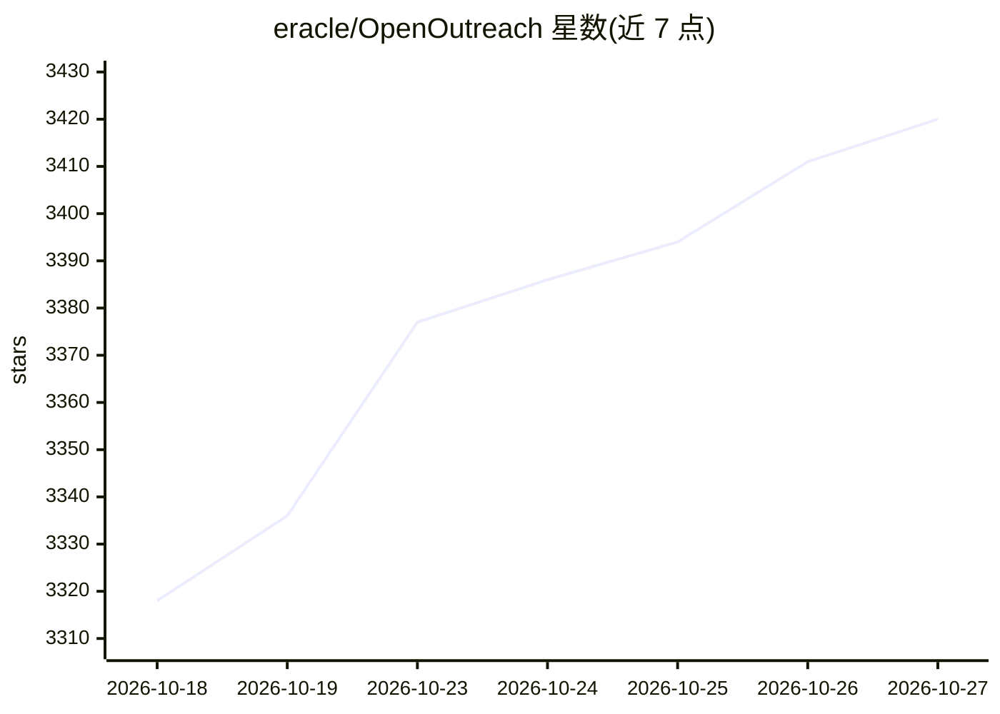

# eracle/OpenOutreach

⭐ 3,420 · Python · GPL-3.0 · 推送 2026-10-23 · [GitHub](https://github.com/eracle/OpenOutreach) · [官网](https://openoutreach.app) · 个人维护

**自托管的 B2B 线索挖掘 AI agent：描述产品即找人选人并发信**

自托管 CLI 编排器，组合两个子程序：OpenOutFind 负责从授权数据源（BetterContact Lead Finder）发现候选、用 LLM 按用户描述所学 ICP 逐个判定并写出理由、经置信门控付费解析工作邮箱；OpenOutSend 负责从用户自己的邮箱撰写并发送开场邮件（含发送窗口/日上限/节奏守卫）。面向自带 LLM 与数据源 API key 的销售/增长人员，无浏览器、无爬取。输出 CSV 兼容 Instantly/Smartlead 导入列名；学习环路部分自述为尚在实验、未证明优于随机。通过 uv 一条命令安装，附带 Claude Code 插件与技能文件。

## 筛选速览

| 维度 | 判定 | 备注 |
|---|---|---|
| AI 角色 | `ai-native` | 本体是模型或模型工具 |
| 许可风险 | `viral` | GPL-3.0 |
| 部署形态 | `library` | 以包/库形式分发 |
| 模型依赖 | — | README 未给出锁定关系 |
| 硬件要求 | — | 无带数字的原话,不猜 |
| 安装摩擦 | `low` | 无编译、无系统依赖或容器化 |
| 成熟度 | `idea` | |

## 能力要点

- 输入为一句产品描述，LLM 生成检索关键词并在授权数据源中翻页寻人
- 每个线索附 LLM 写出的文字版入选理由，无评分列
- 置信门控按需付费：仅对最优线索花费邮箱解析额度
- 导出 CSV 列名对齐 Instantly/Smartlead，无需列映射即可导入

## 适用场景

- 我不想上传名单，直接描述产品和目标市场来找潜在客户
- 在本地跑完整流程：发现、判定、买邮箱、从我的邮箱发出首封邮件
- 把带理由的线索 CSV 导入我现有的邮件序列工具

## 场景标签

 · 领域:销售营销自动化

## 证据(README 行号)

> L20: OpenOutreach is a **self-hosted, open-source lead finder that qualifies for you — and then writes
> L206: 4. **An LLM qualifies each candidate** against your ICP and **writes down why**. A Gaussian Process

## 星数曲线

2026-10-18 3,318 → 2026-10-27 3,420（+102）

---
*卡片 v1 · prompt 1.4 · 生成 2026-10-20 · 置信度 mid · 依据 README sha `dd02e7230547` · [字段定义](../../DATASET.md)*
