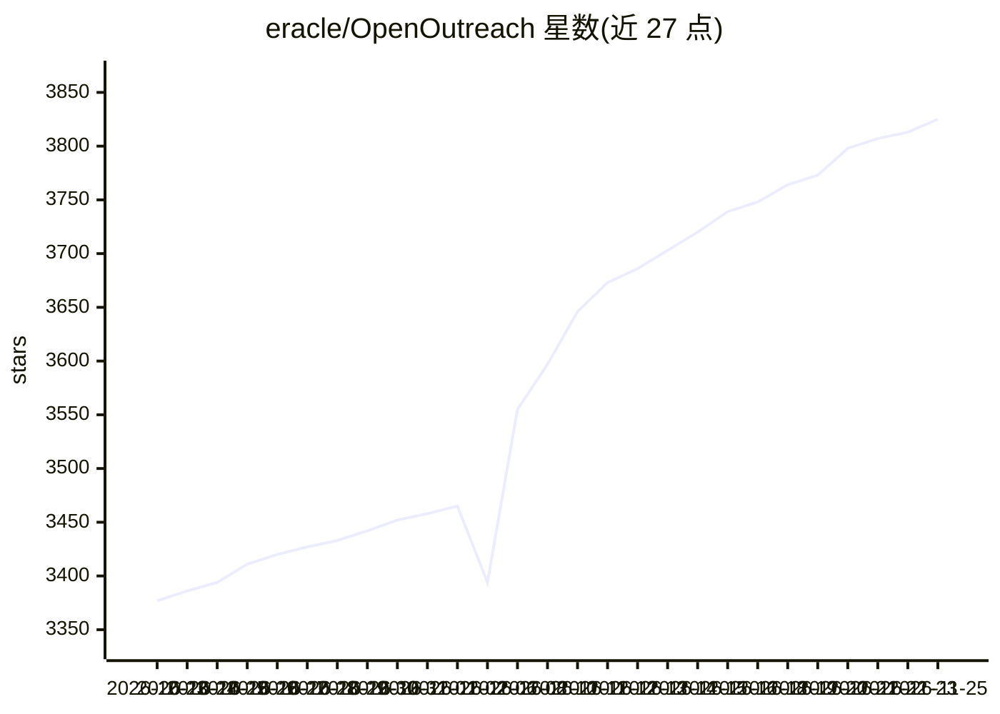

# eracle/OpenOutreach

⭐ 3,825 · Python · Apache-2.0 · 推送 2026-11-20 · [GitHub](https://github.com/eracle/OpenOutreach) · [官网](https://openoutreach.app) · 个人维护

**自托管 CLI：为 B2B 卖家自动找线索、判定匹配理由并发邮件**

自托管的开源线索开发代理：用户输入产品描述与目标市场，系统从授权数据源检索候选者，LLM 依据推断的 ICP 逐人判定是否匹配并写出理由，通过置信门控决定是否付费解析工作邮箱，再从用户自己的邮箱发出开场邮件。由 OpenOutFind（发现/判定/CRM）与 OpenOutSend（发送代理/发信守卫）两个独立程序组成，本仓库为编排器。需要 LLM API key、BetterContact key 与邮箱 SMTP 凭据；状态存于 ~/.openoutreach，无浏览器、无容器。

## 筛选速览

| 维度 | 判定 | 备注 |
|---|---|---|
| AI 角色 | `ai-native` | 本体是模型或模型工具 |
| 许可风险 | `permissive` | Apache-2.0 |
| 部署形态 | `library` | 以包/库形式分发 |
| 模型依赖 | — | README 未给出锁定关系 |
| 硬件要求 | — | 无带数字的原话,不猜 |
| 安装摩擦 | `low` | 无编译、无系统依赖或容器化 |
| 成熟度 | — | 结构信号不足 |

## 能力要点

- 发现→判定→门控→解析→撰写→发送六步流水线，判定理由随线索以纯文本输出
- CSV 输出列名兼容 Instantly/Smartlead 导入器，无需字段映射
- 附带 Claude Code 插件与通用 SKILL.md，其他 agent 可直接调用同一 CLI
- LLM key 与 SMTP 登录在引导阶段即被验证；状态持久化于 ~/.openoutreach

## 适用场景

- 用一句话产品描述代替手工整理线索清单
- 把带判定理由的线索导出到既有邮件序列工具
- 在 agent 会话里直接调用 find/send 拉取线索

## 场景标签

`工作流自动化` · 领域:效率与自动化

## 证据(README 行号)

> L22: OpenOutreach is a **self-hosted, open-source lead finder that qualifies for you — and then writes
> L216: 4. **An LLM qualifies each candidate** against your ICP and **writes down why**. A Gaussian Process
> L220: 6. **The outreach agent writes each opener** from the same product description, and the send guards

## 星数曲线

2026-10-23 3,377 → 2026-11-25 3,825（+448）

---
*卡片 v1 · prompt 1.4 · 生成 2026-11-23 · 置信度 high · 依据 README sha `2331dffa07df` · [字段定义](../../DATASET.md)*
