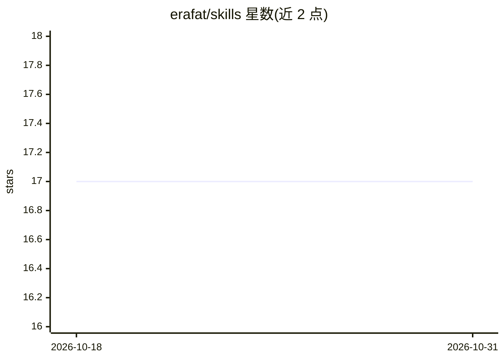

# erafat/skills

⭐ 17 · JavaScript · MIT · 推送 2026-10-15 · [GitHub](https://github.com/erafat/skills) · 个人维护 · 中文 README

**供 Codex 与 Claude 复用的技能集合：文献引用、小红书卡片、CV 审查等**

包含多个自包含技能的仓库，每个技能有自己的 SKILL.md 与脚本、模板等支持文件。技能覆盖：检测手稿中需引用的声明并从生物医学来源补引（cite-them-all）、Markdown 转小红书图片卡片（md-to-xhs-cards）、需用户确认的 Word CV 更新审查流程（cv-update-review）、分阶段学术/临床手稿生产工作流（manuscript-production），以及第三方引入的解剖学等距插图技能（anatomy）。安装方式为 git clone 到 ~/.claude/skills 并为 Codex 建立符号链接，无自动后台同步，Claude 网页/移动端不读取这些本地目录。

## 筛选速览

| 维度 | 判定 | 备注 |
|---|---|---|
| AI 角色 | `ai-ecosystem` | LLM/agent 周边工具 |
| 许可风险 | `permissive` | MIT |
| 部署形态 | `None` |  |
| 模型依赖 | — | README 未给出锁定关系 |
| 硬件要求 | — | 无带数字的原话,不猜 |
| 安装摩擦 | `low` | 无编译、无系统依赖或容器化 |
| 成熟度 | — | 结构信号不足 |

## 能力要点

- 每个技能自包含（SKILL.md + scripts/references/模板/示例）
- Markdown 转小红书图片卡片并保留结构与本地图片
- CV 更新审查带确认门与受保护的带日期副本
- Git 克隆 + 符号链接实现 Claude 与 Codex 共享安装

## 适用场景

- 为 Claude Code / Codex 增加学术写作与引用补全能力
- 把 Markdown 笔记转成小红书图片卡片
- 在编辑 Word 简历前跑一套带确认的审查流程

## 场景标签

`科研工具` `AI 写作` · 领域:内容生成

## 证据(README 行号)

> L3: Reusable skills for Codex and Claude.
> L5: This repository contains multiple self-contained skills. Each skill has its own `SKILL.md` and support files (`scrip

## 星数曲线

2026-10-18 17 → 2026-10-31 17（+0）

---
*卡片 v1 · prompt 1.4 · 生成 2026-10-29 · 置信度 high · 依据 README sha `b2236c6e77cb` · [字段定义](../../DATASET.md)*
