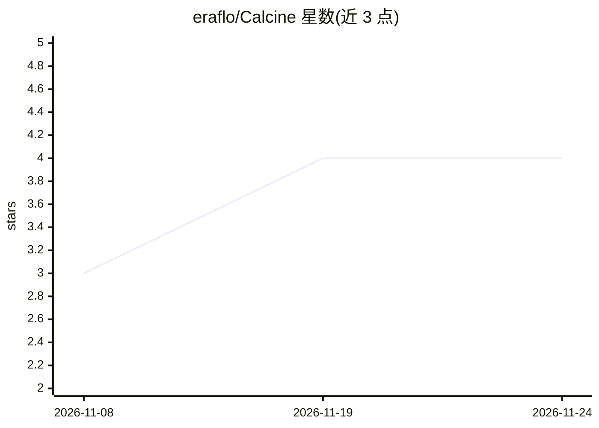

# eraflo/Calcine

⭐ — · [GitHub]() · 个人维护

**在骁龙 NPU 上运行本地大模型的桌面端与安全 OpenAI 兼容 API**

面向 Qualcomm Snapdragon 平台的桌面应用，封装 GenieX 命令行：下载模型、在 Hexagon NPU/GPU/CPU 上对话，并在本地服务器前提供带鉴权的 OpenAI 兼容 API 网关（默认 127.0.0.1:18181）。支持每应用 API key、请求队列与日志、Ollama API 翻译（可应答 11434 端口）、结构化输出与工具调用、语音转录端点、NPU/GPU/CPU 负载监测与基准测试。需 Windows 11 on Arm 或 Linux ARM64 的骁龙设备；首启自动下载安装 GenieX，无账户、无遥测。

## 筛选速览

| 维度 | 判定 | 备注 |
|---|---|---|
| AI 角色 | `ai-ecosystem` | LLM/agent 周边工具 |
| 许可风险 | `permissive` | — |
| 部署形态 | `desktop` | 安装包/桌面程序 |
| 模型依赖 | local-ok | 支持本地模型 |
| 硬件要求 | — | 无带数字的原话,不猜 |
| 安装摩擦 | `low` | 无编译、无系统依赖或容器化 |
| 成熟度 | — | 结构信号不足 |

## 能力要点

- OpenAI 兼容本地 API 网关：每应用 key、请求队列、不记录 prompt 的日志
- 同时翻译 Ollama API，可占用 11434 端口服务仅支持 Ollama 的应用
- 语音转录端点 /v1/audio/transcriptions，本地模型执行
- NPU/GPU/CPU 实时负载、能耗计量与 geniex-bench 基准（CSV 导出）

## 适用场景

- 在骁龙笔记本上把本地模型作为 API 服务给其他应用调用
- 运行只兼容 Ollama 接口的本地应用接入 NPU 模型
- 对比不同计算单元上的推理速度与每 token 能耗
- 无头服务器上用 calcine-cli 提供同样的 API

## 场景标签

`推理引擎` · 领域:训练与推理

## 证据(README 行号)

> L8: chat with them on the Hexagon NPU, and give every app on your PC a secure, OpenAI-compatible API.
> L57: - **OpenAI-compatible API.** On `127.0.0.1:18181`, GenieX's default port, with per-app keys,
> L61: - **Without the window.** `calcine-cli` serves the same API from a terminal or a server,

## 星数曲线

2026-11-08 3 → 2026-11-24 4（+1）

---
*卡片 v1 · prompt 1.4 · 生成 2026-11-21 · 置信度 high · 依据 README sha `bb46889f9ba5` · [字段定义](../../DATASET.md)*
