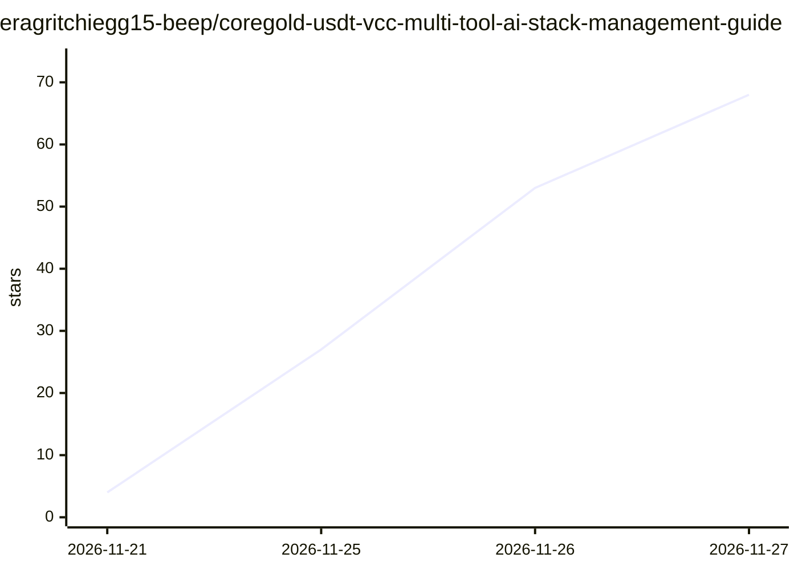

# eragritchiegg15-beep/coregold-usdt-vcc-multi-tool-ai-stack-management-guide

⭐ 68 · 推送 2026-11-20 · [GitHub](https://github.com/eragritchiegg15-beep/coregold-usdt-vcc-multi-tool-ai-stack-management-guide) · [官网](https://app.coregold.io/signup?invite_code=ADvlj9b) · 个人维护

**面向 AI 工具栈用户的 CoreGold 虚拟卡开户与绑卡指南**

该仓库内容为一篇操作指南：介绍 CoreGold 平台的个人/团队开卡方案选择、测试卡与常用卡分离的记录管理习惯、账单地址填写注意事项，以及通过 TRON (TRC20) 网络充值 USDT 后绑定 Apple Pay / Google Pay 的分步流程（注册、充值、选方案、查看卡片与验证码绑定）。README 含邀请码注册链接，AI 相关内容仅作为写作背景语境出现。

## 筛选速览

| 维度 | 判定 | 备注 |
|---|---|---|
| AI 角色 | `ai-knowledge` | 知识聚合/清单类 |
| 许可风险 | `none` | — |
| 部署形态 | `None` |  |
| 模型依赖 | — | README 未给出锁定关系 |
| 硬件要求 | — | 无带数字的原话,不猜 |
| 安装摩擦 | `low` | 无编译、无系统依赖或容器化 |
| 成熟度 | — | 结构信号不足 |

## 能力要点

- 分步教程：注册、USDT (TRC20) 充值、选卡、绑卡四步流程
- 介绍 Apple Pay 与 Google Pay 绑定流程与邮箱验证码步骤
- 列出卡片管理功能：查看卡号/CVV/余额、充值、提现、冻结

## 适用场景

- 给多个 AI 订阅服务付费前想开一张虚拟卡
- 想在 Apple Pay / Google Pay 中绑定虚拟卡
- 需要以 USDT 方式向卡内充值

## 场景标签

`教程课程` · 领域:学习与行业

## 证据(README 行号)

> L7: In November 2026, developers, creators, and teams routinely combine multiple AI models, apps, and online services in
> L9: ## Practical Knowledge for Multi-Tool Users

## 星数曲线

2026-11-21 4 → 2026-11-27 68（+64）

---
*卡片 v1 · prompt 1.4 · 生成 2026-11-21 · 置信度 mid · 依据 README sha `d0f59b0733d5` · [字段定义](../../DATASET.md)*
