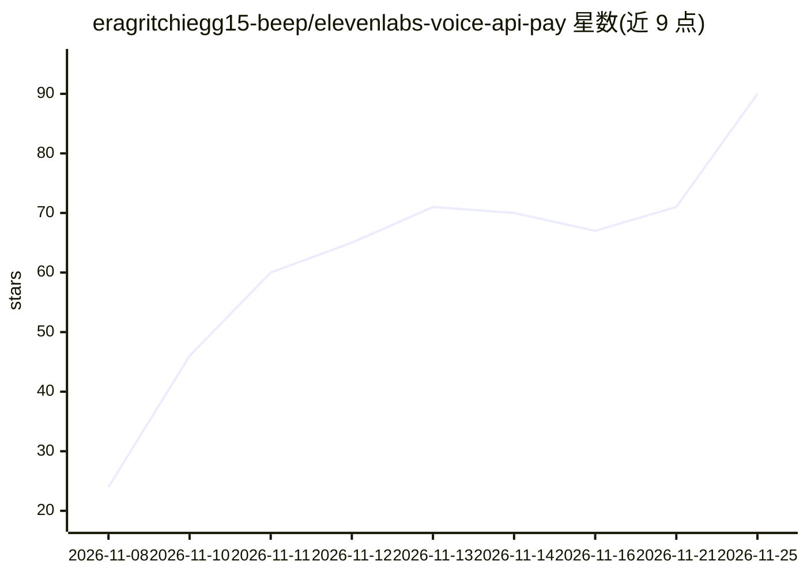

# eragritchiegg15-beep/elevenlabs-voice-api-pay

⭐ 90 · 推送 2026-11-03 · [GitHub](https://github.com/eragritchiegg15-beep/elevenlabs-voice-api-pay) · [官网](https://app.coregold.io/signup?invite_code=ADvlj9b) · 个人维护 · 中文 README

**推广 CoreGold 虚拟卡为 ElevenLabs 等平台付费的营销文**

仓库内容为一份付费指南式推广文档，而非可运行的软件：声称国内卡为 ElevenLabs Creator/Pro 订阅付款时易被 Stripe 拦截、多号同卡会关联封禁，进而宣传 CoreGold 商业虚拟卡（USDT 入金、单卡限额、一号一卡）作为解决方案，并附开卡步骤与控制台入口。仓库中未见代码、安装命令或可验证的技术实现，全文为单一服务商导购内容。

## 筛选速览

| 维度 | 判定 | 备注 |
|---|---|---|
| AI 角色 | `ai-knowledge` | 知识聚合/清单类 |
| 许可风险 | `none` | — |
| 部署形态 | `None` |  |
| 模型依赖 | — | README 未给出锁定关系 |
| 硬件要求 | — | 无带数字的原话,不猜 |
| 安装摩擦 | `low` | 无编译、无系统依赖或容器化 |
| 成熟度 | — | 结构信号不足 |

## 能力要点

- 内容为 CoreGold 商业虚拟卡的开卡与绑卡步骤说明
- 涉及 ElevenLabs Creator（$22/月）/Pro（$99/月）订阅支付场景
- 仓库内无代码、无安装与运行方式

## 适用场景

- 阅读者可了解其声称的海外 TTS 平台支付拦截问题
- 按其指引开通 CoreGold 虚拟卡（营销导向，非中立信息）

## 场景标签

 · 领域:支付/营销内容

## 证据(README 行号)

> L2: ElevenLabs 与海外 AI 拟真音频平台充值实战：CoreGold 商业虚拟卡破解 Stripe 大额扣费拦截与防滥用连坐。
> L33: 👉 **立即进入 CoreGold 开卡控制台**

## 星数曲线

2026-11-08 24 → 2026-11-25 90（+66）

---
*卡片 v1 · prompt 1.4 · 生成 2026-11-18 · 置信度 high · 依据 README sha `a7fba5556822` · [字段定义](../../DATASET.md)*
