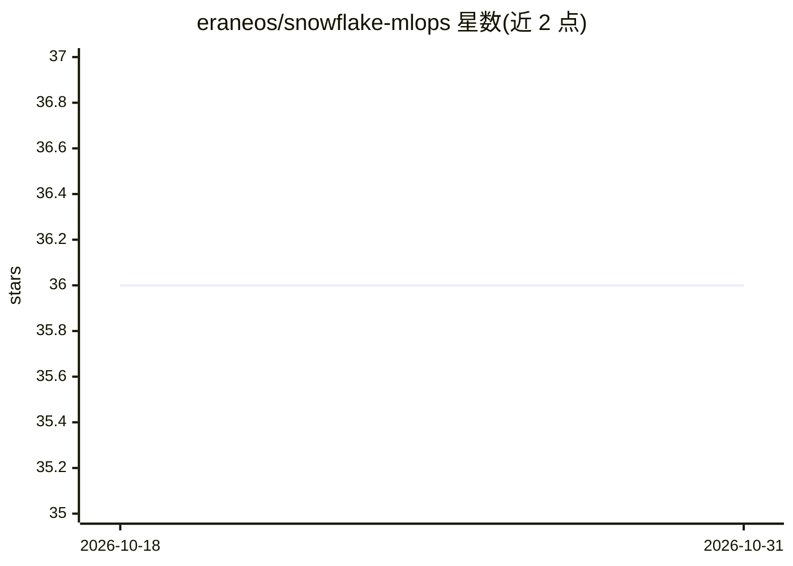

# eraneos/snowflake-mlops

⭐ 36 · Python · Apache-2.0 · 推送 2026-05-20 · [GitHub](https://github.com/eraneos/snowflake-mlops) · [官网](https://eraneos.github.io/snowflake-mlops/) · 组织维护

**面向工程团队的 Snowflake 端到端 MLOps 参考代码库**

Eraneos 维护的开源参考 monorepo，演示如何在 Snowflake 上组织端到端 MLOps：以 hub-spoke 架构（中心平台基础设施 + 团队项目 spoke）串联 Snowflake Feature Store、Model Registry、Tasks DAG 编排训练与推理、TASK_HISTORY 可观测性及数据库/角色/仓库等配套原语。全部通过一个物流包裹 PUDO 容量预测的端到端示例展示，数据为本地合成数据，fresh checkout 即可跑通。前置要求 Snowflake 账号（首次需 ACCOUNTADMIN）、Python 3.10 与 uv 包管理器，按组件 Makefile 逐 verb 部署。

## 筛选速览

| 维度 | 判定 | 备注 |
|---|---|---|
| AI 角色 | `ai-ecosystem` | LLM/agent 周边工具 |
| 许可风险 | `permissive` | Apache-2.0 |
| 部署形态 | `None` |  |
| 模型依赖 | — | README 未给出锁定关系 |
| 硬件要求 | — | 无带数字的原话,不猜 |
| 安装摩擦 | `low` | 无编译、无系统依赖或容器化 |
| 成熟度 | — | 结构信号不足 |

## 能力要点

- hub-spoke 架构串联 Feature Store / Model Registry / Tasks DAG
- 单一端到端示例（PUDO 容量预测），数据全部本地合成
- 设计默认采用 Snowflake 原生原语，外部依赖仅在无原生替代时引入
- 各组件独立锁定依赖并由 Makefile 编排，根目录无聚合器

## 适用场景

- 作为多团队生产环境 Snowflake MLOps 的参考蓝本
- 学习 Feature Store 与 Model Registry 如何在实际项目中配合
- 评估 Snowflake 原生 MLOps 原语的覆盖范围与组合方式

## 场景标签

`MLOps` · 领域:训练与推理

## 证据(README 行号)

> L8: An open-source reference monorepo for end-to-end MLOps on Snowflake. The repo serves two complementary purposes:
> L12: 2. **Showcase the breadth of Snowflake-native MLOps primitives and how they interact.** The repo exercises the Snow

## 星数曲线

2026-10-18 36 → 2026-10-31 36（+0）

---
*卡片 v1 · prompt 1.4 · 生成 2026-10-25 · 置信度 high · 依据 README sha `f64051375b92` · [字段定义](../../DATASET.md)*
