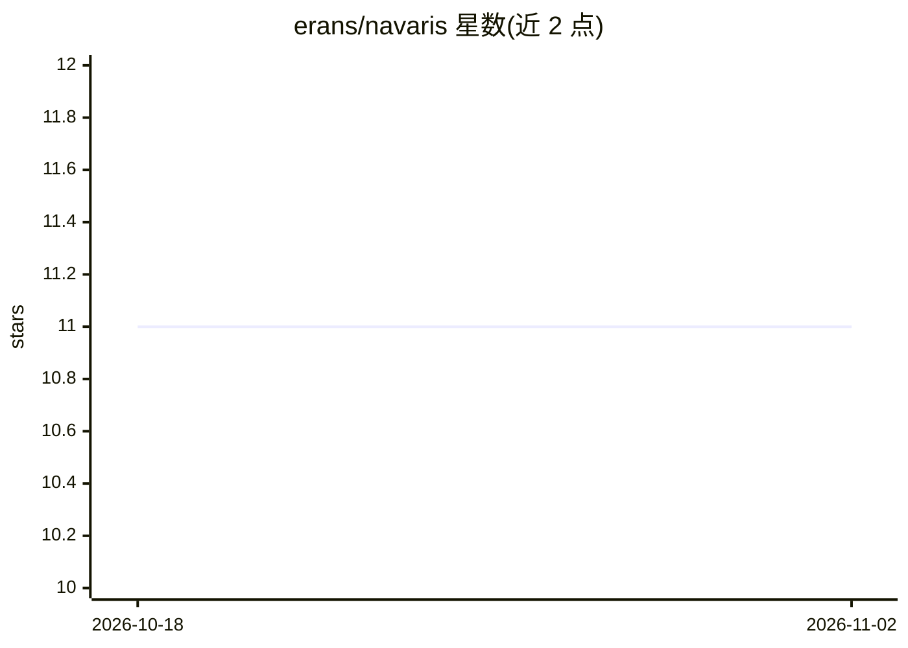

# erans/navaris

⭐ 11 · Go · Apache-2.0 · 推送 2026-08-07 · [GitHub](https://github.com/erans/navaris) · 个人维护

**沙箱控制平面：统一 API 管理 Incus 容器与 Firecracker microVM**

跨后端的隔离执行环境管理服务：通过统一 REST API 与 CLI 对 Incus 系统容器和 Firecracker microVM 两种后端做创建、启停、快照、镜像、克隆、端口转发与交互会话等全生命周期管理，后端可按镜像格式自动路由或显式指定。面向需要运行不可信代码、按需开发环境或混合隔离级别的平台/基础设施开发者。提供 Docker 一体化镜像与 Go 源码构建两种途径；Firecracker 后端需 /dev/kvm，Docker 运行需 --privileged。内置可选 MCP 端点，可将沙箱作为 AI agent 工具暴露。

## 筛选速览

| 维度 | 判定 | 备注 |
|---|---|---|
| AI 角色 | `ai-enhanced` | 去掉 AI 部分产品仍成立 |
| 许可风险 | `permissive` | Apache-2.0 |
| 部署形态 | `self-host` | docker 或自建部署 |
| 模型依赖 | — | README 未给出锁定关系 |
| 硬件要求 | — | 无带数字的原话,不猜 |
| 安装摩擦 | `low` | 无编译、无系统依赖或容器化 |
| 成熟度 | — | 结构信号不足 |

## 能力要点

- 统一 API/CLI 同时管理 Incus 容器与 Firecracker microVM，后端自动路由
- 快照、镜像提升、CoW 克隆与 Firecracker 内存 CoW fork（秒级派生子沙箱）
- 运行时资源调整与限时 boost（沙箱内经 guest socket 自助申请，令牌桶限速）
- 可选 MCP server 将沙箱暴露为 AI agent 工具（默认关闭）

## 适用场景

- 为 AI agent 提供隔离的代码执行环境（MCP 工具）
- 平台按需提供开发环境，用户无需关心底层是容器还是 microVM
- 多租户场景下用 microVM 隔离运行不可信代码
- 通过快照与恢复做可复现的执行状态检查点

## 场景标签

 · 领域:计算基础设施/沙箱运行时

## 证据(README 行号)

> L14: - **Run untrusted code** with microVM-level isolation without rewriting your orchestration layer
> L79: - **MCP server**: expose sandboxes as Model Context Protocol tools for AI agents — see docs/mcp.md
> L187: |`--mcp-enabled`|`false`|Mount the embedded MCP endpoint (see docs/mcp.md)|

## 星数曲线

2026-10-18 11 → 2026-11-02 11（+0）

---
*卡片 v1 · prompt 1.4 · 生成 2026-11-02 · 置信度 mid · 依据 README sha `fc9494dc02aa` · [字段定义](../../DATASET.md)*
