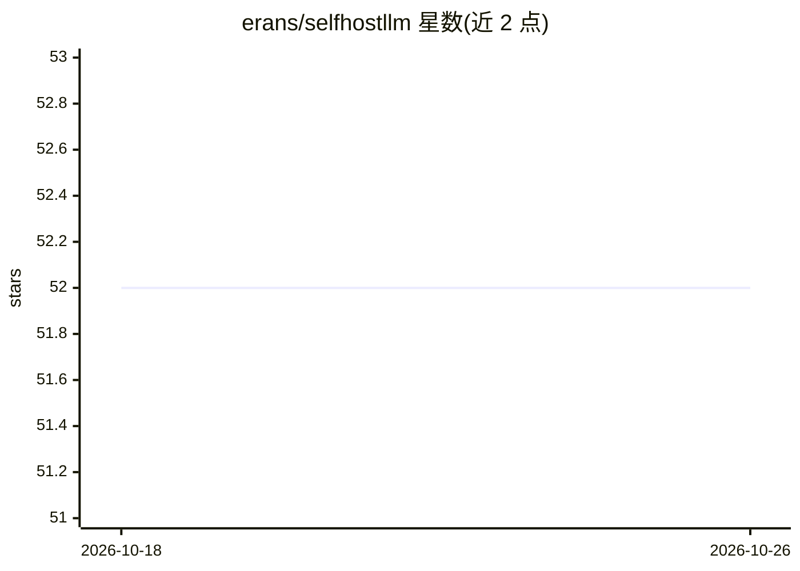

# erans/selfhostllm

⭐ 52 · HTML · MIT · 推送 2026-06-11 · [GitHub](https://github.com/erans/selfhostllm) · [官网](https://selfhostllm.org) · 个人维护

**自托管 LLM 的 GPU 显存与并发请求数估算网页计算器**

面向本地部署 LLM 的规划工具：输入 GPU 数量与单卡显存、模型参数量、上下文长度和量化方式，按公式（可用显存 ÷ 每请求 KV 缓存）估算最大并发请求数；对 Mixtral 等 MoE 模型自动按活跃参数而非总参数计算。内置 100+ 模型显存档案（Qwen、DeepSeek、Llama、Kimi 等），支持 1K–1M 上下文预设、URL 分享、Apple Silicon 专用版本，提供在线演示，基于最坏情况假设（所有请求占满上下文窗口）。

## 筛选速览

| 维度 | 判定 | 备注 |
|---|---|---|
| AI 角色 | `ai-ecosystem` | LLM/agent 周边工具 |
| 许可风险 | `permissive` | MIT |
| 部署形态 | `None` |  |
| 模型依赖 | — | README 未给出锁定关系 |
| 硬件要求 | — | 无带数字的原话,不猜 |
| 安装摩擦 | `low` | 无编译、无系统依赖或容器化 |
| 成熟度 | — | 结构信号不足 |

## 能力要点

- 按公式估算最大并发请求数：可用显存 ÷ 每请求 KV 缓存
- MoE 模型自动按活跃参数计算显存需求
- 100+ 模型显存档案与多种量化选项（FP16/INT8/INT4/MXFP4）
- 提供 Apple Silicon Mac 专用版本与 URL 配置分享

## 适用场景

- 采购或规划 GPU 前估算某模型能否本地部署
- 评估现有 GPU 配置可承载的最大并发请求数
- 对比不同量化方式对显存占用的影响

## 场景标签

 · 领域:LLM 部署规划/工具

## 证据(README 行号)

> L3: A web-based calculator for estimating GPU memory requirements and maximum concurrent requests for self-hosted LLM in
> L9: This tool helps you calculate how many concurrent requests your GPU setup can handle when running large language mod
> L22: Max Concurrent Requests = Available Memory / KV Cache per Request

## 星数曲线

2026-10-18 52 → 2026-10-26 52（+0）

---
*卡片 v1 · prompt 1.4 · 生成 2026-10-24 · 置信度 high · 依据 README sha `7dbd219f38c9` · [字段定义](../../DATASET.md)*
