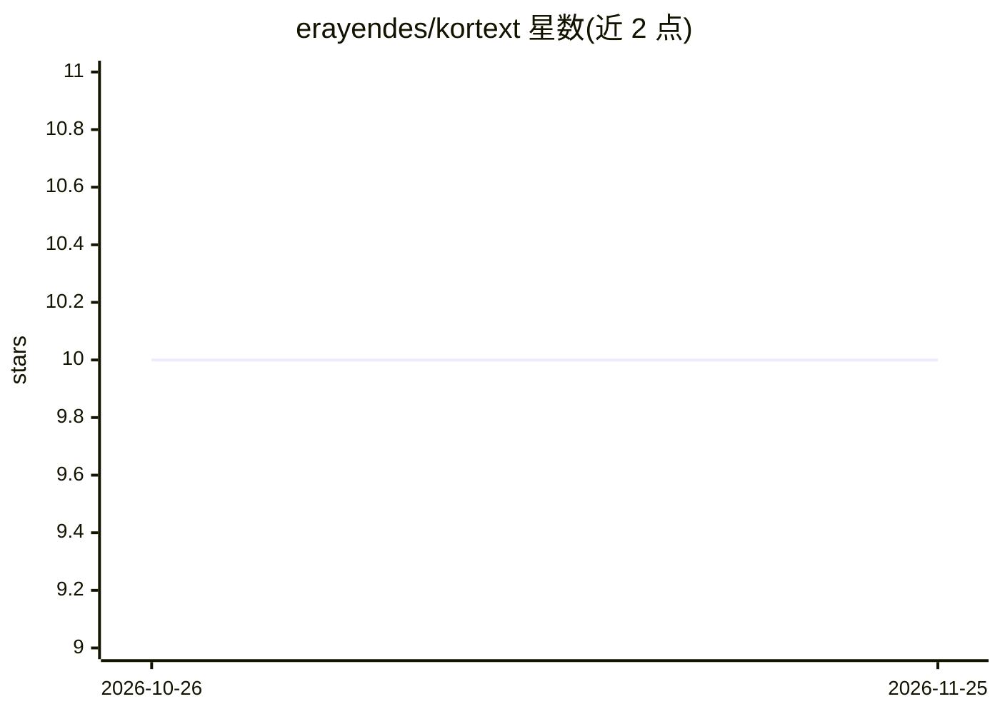

# erayendes/kortext

⭐ 10 · TypeScript · MIT · 推送 2026-11-20 · [GitHub](https://github.com/erayendes/kortext) · [官网](https://www.npmjs.com/package/kortext) · 个人维护

**为 AI 驱动开发生成项目宪法文档的本地 CLI 工具**

从用户提供的 BRIEF.md 出发，以 10 个专家角色（产品经理、架构师、安全工程师等）的流水线形式生成 14 份架构文档（PRODUCT.md、STACK.md、ARCHITECTURE.md 等），作为后续 AI 编码工具反复回读的单一事实来源。每份文档交由用户审阅，可携带问题、变更请求并触发回环重写；也支持从既有代码库起步。本身不签名、不持有 API key、不采集遥测，代码写作交由用户已有的 agent CLI（如 Claude、Codex）完成。

## 筛选速览

| 维度 | 判定 | 备注 |
|---|---|---|
| AI 角色 | `ai-ecosystem` | LLM/agent 周边工具 |
| 许可风险 | `permissive` | MIT |
| 部署形态 | `None` |  |
| 模型依赖 | — | README 未给出锁定关系 |
| 硬件要求 | — | 无带数字的原话,不猜 |
| 安装摩擦 | `low` | 无编译、无系统依赖或容器化 |
| 成熟度 | — | 结构信号不足 |

## 能力要点

- BRIEF.md 输入，10 个角色生成 14 份架构文档
- 文档审阅、行级提问与跨文档变更请求的回环机制
- 本地优先：无登录、无自有 API key、无遥测
- 支持从既有代码库初始化项目状态

## 适用场景

- 在让 agent 写代码前先固化需求与架构约定
- 防止 AI 编码过程中丢失已商定的规则
- 为进行中的项目补齐结构化文档

## 场景标签

 · 领域:开发者工具/AI 辅助开发流程

## 证据(README 行号)

> L19: From the **`BRIEF.md`** you provide, **10 expert personas** write **14 architecture documents** — the one source of
> L37: From there on you carry on building with whatever AI tool, in whatever client, you already use.

## 星数曲线

2026-10-26 10 → 2026-11-25 10（+0）

---
*卡片 v1 · prompt 1.4 · 生成 2026-11-19 · 置信度 mid · 依据 README sha `34343cf87d28` · [字段定义](../../DATASET.md)*
