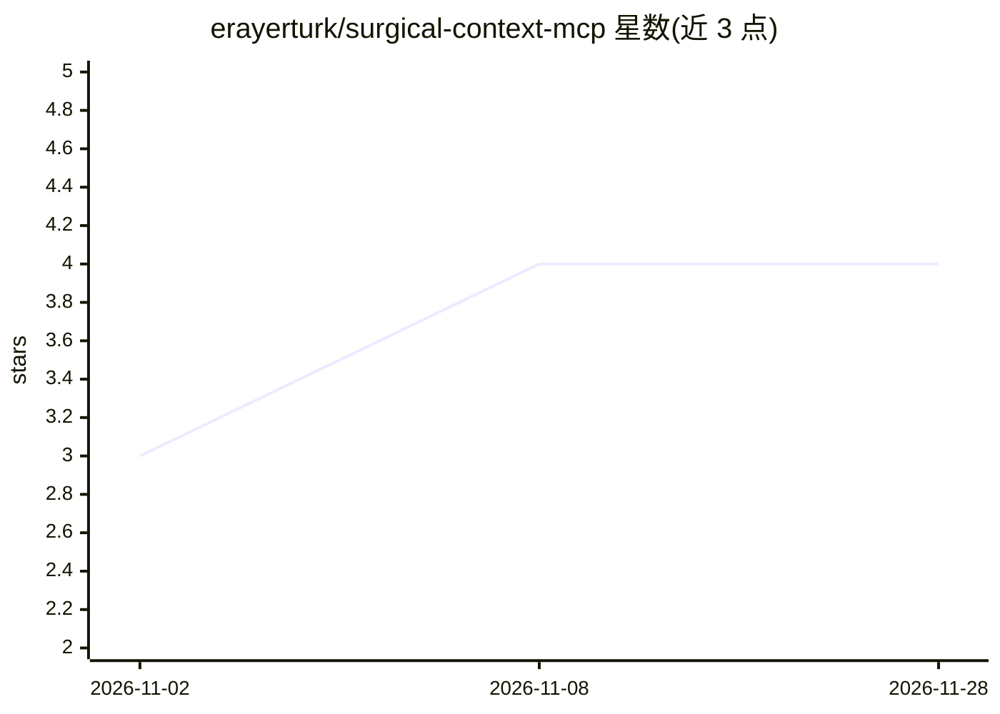

# erayerturk/surgical-context-mcp

⭐ 4 · Python · MIT · 推送 2026-11-01 · [GitHub](https://github.com/erayerturk/surgical-context-mcp) · [官网](https://pypi.org/project/surgical-context-mcp/) · 个人维护

**为 AI 编码代理提供 AST 代码上下文的 MCP 服务器，减少 token 消耗**

基于嵌入式 SQLite 与 Tree-sitter 构建的 MCP 服务器，为 Claude Code、Cursor、Windsurf、Cline 等 AI 编码代理提供代码知识图谱：get_edit_context 返回带行号的目标函数体、文件骨架、调用者窗口等预算化上下文包（≤4000 token），check_rename_or_delete 做重构安全检查，另提供跨语言契约链接、i18n 校验、测试发现与 git diff 影响分析。索引零 LLM 成本，通过 Claude Code PreToolUse 钩子阻止大文件全文读取。小文件（<300 行）自动回退为返回完整文件。

## 筛选速览

| 维度 | 判定 | 备注 |
|---|---|---|
| AI 角色 | `ai-ecosystem` | LLM/agent 周边工具 |
| 许可风险 | `permissive` | MIT |
| 部署形态 | `library` | 以包/库形式分发 |
| 模型依赖 | — | README 未给出锁定关系 |
| 硬件要求 | — | 无带数字的原话,不猜 |
| 安装摩擦 | `medium` | 含编译或系统依赖之一 |
| 成熟度 | — | 结构信号不足 |

## 能力要点

- get_edit_context 输出 ≤4000 token 的编辑上下文包（函数体、骨架、调用者 ±5 行窗口）
- check_rename_or_delete 检查 AST 调用者、继承覆盖、场景/模板连接与动态字符串引用
- 基于 Tree-sitter 与嵌入式 SQLite，零 API token 索引，自动按 mtime+SHA-1 刷新
- Claude Code PreToolUse 钩子阻止 >300 行文件的全文 Read

## 适用场景

- 在大型文件中编辑函数时只读取必要的代码上下文
- 跨文件重命名或修改函数签名前检查所有调用点
- Godot/Go/JS 等多语言单仓库中追踪事件与数据流
- 长时间多子代理编码会话中控制上下文膨胀

## 场景标签

`知识图谱` · 领域:知识与检索

## 证据(README 行号)

> L13: > `surgical-context-mcp` is a zero-LLM-cost, embedded SQLite + Tree-sitter Code Knowledge Graph and MCP Server that
> L27: That's it — your agent now calls `get_edit_context` instead of reading whole files. Using Cursor, Windsurf, Cline o
> L72:  Built on native C Tree-sitter grammars and embedded SQLite (`WAL` mode). Indexes **~600 files in `< 0.6` seconds**

## 星数曲线

2026-11-02 3 → 2026-11-28 4（+1）

---
*卡片 v1 · prompt 1.4 · 生成 2026-11-21 · 置信度 high · 依据 README sha `080d58a20b53` · [字段定义](../../DATASET.md)*
