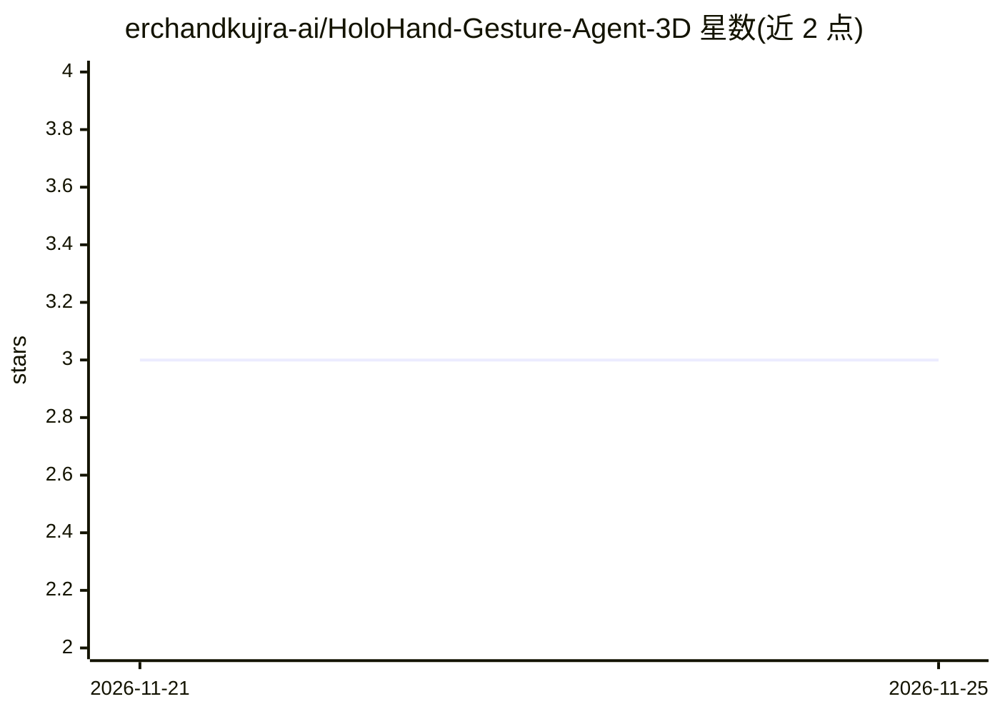

# erchandkujra-ai/HoloHand-Gesture-Agent-3D

⭐ 3 · Python · MIT · 推送 2026-11-01 · [GitHub](https://github.com/erchandkujra-ai/HoloHand-Gesture-Agent-3D) · 个人维护

**基于摄像头手势识别的 3D 无接触交互探索项目**

一个探索性 Python 项目，通过摄像头实时追踪手部动作、识别手势，并将其映射到 3D 可视化环境中实现无接触人机交互。README 以模板形式提供克隆仓库、创建虚拟环境、安装依赖、运行入口的完整步骤，同时明确提示依赖以 requirements.txt 为准、项目结构需按实际文件更新，并列出未来计划：扩充手势类别、提升识别精度、改进实时性能等。个人开发者作品。

## 筛选速览

| 维度 | 判定 | 备注 |
|---|---|---|
| AI 角色 | `ai-native` | 本体是模型或模型工具 |
| 许可风险 | `permissive` | MIT |
| 部署形态 | `library` | 以包/库形式分发 |
| 模型依赖 | — | README 未给出锁定关系 |
| 硬件要求 | — | 无带数字的原话,不猜 |
| 安装摩擦 | `low` | 无编译、无系统依赖或容器化 |
| 成熟度 | `idea` | |

## 能力要点

- 基于摄像头的实时手势识别与手部追踪
- 手势驱动的 3D 交互可视化
- 技术栈为 Python + OpenCV + MediaPipe

## 适用场景

- 无接触方式与数字界面进行手势交互
- 学习计算机视觉手部追踪的入门实践项目

## 场景标签

`目标检测` · 领域:感知与多模态

## 证据(README 行号)

> L4: An interactive 3D hand gesture recognition project that explores human-computer interaction using computer vision, h
> L14: - Real-time hand gesture recognition

## 星数曲线

2026-11-21 3 → 2026-11-25 3（+0）

---
*卡片 v1 · prompt 1.4 · 生成 2026-11-22 · 置信度 high · 依据 README sha `5feed6bcc272` · [字段定义](../../DATASET.md)*
