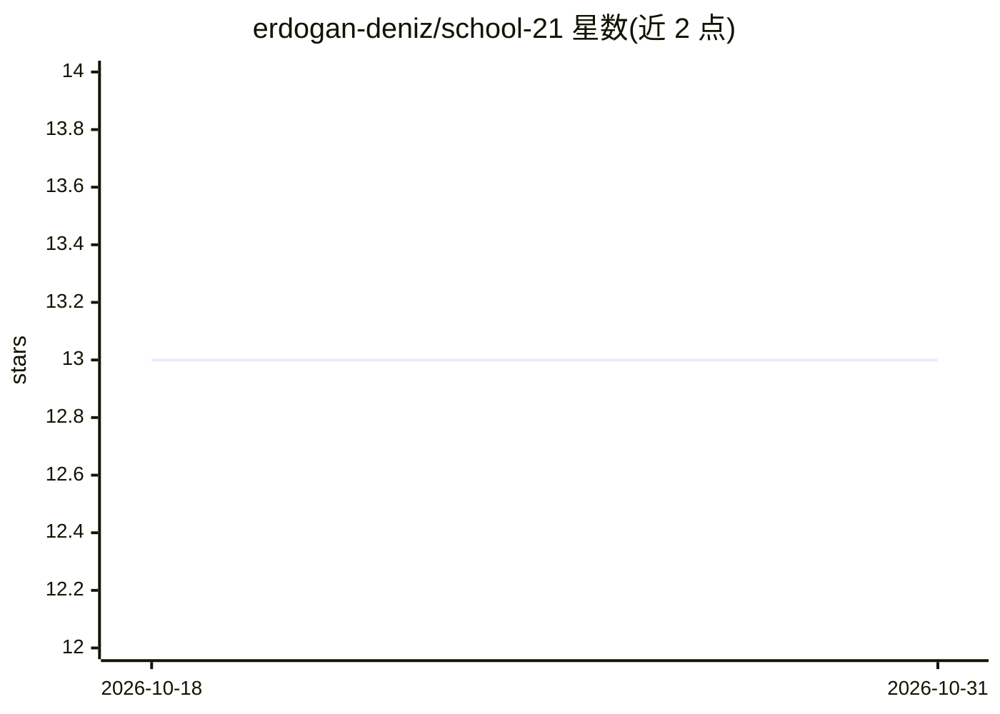

# erdogan-deniz/school-21

⭐ 13 · Jupyter Notebook · NOASSERTION · 推送 2026-10-29 · [GitHub](https://github.com/erdogan-deniz/school-21) · [官网](https://21-school.ru) · 个人维护

**School 21（42 网络）已完成课程项目集合：C/C++/Python/ML/DevOps**

个人在 School 21 免费数字技术学校（42 网络体系）完成的课程项目集合仓库：按语言/方向分为 algorithms、c、cpp、python、machine_learning、devops、sql、qa 等 12 个目录，共 38 个子项目。README 同时记录作者的平台账户信息（等级 12、技能分、徽章）与同学互评数据。仓库配置 13 个 CI 工作流、lint 门槛、密钥泄露防护栈（gitleaks/bandit/pip-audit），并有 STATUS.md 生产就绪矩阵与 Doxygen+Sphinx 生成的文档站点。

## 筛选速览

| 维度 | 判定 | 备注 |
|---|---|---|
| AI 角色 | `ai-knowledge` | 知识聚合/清单类 |
| 许可风险 | `permissive` | NOASSERTION |
| 部署形态 | `None` |  |
| 模型依赖 | — | README 未给出锁定关系 |
| 硬件要求 | — | 无带数字的原话,不猜 |
| 安装摩擦 | `medium` | 含编译或系统依赖之一 |
| 成熟度 | — | 结构信号不足 |

## 能力要点

- 12 个语言/方向目录下的 38 个已完成子项目
- 13 个 CI 工作流覆盖 lint、构建、密钥检测与发布
- 三层密钥泄露防护（gitleaks pre-commit + secrets CI + bandit/pip-audit）
- STATUS.md 生产就绪矩阵与自动生成的文档站点

## 适用场景

- 查阅 School 21/42 网络课程各阶段项目的实现参考
- 了解该校课程体系覆盖的技能方向
- 参考多语言仓库的 CI 与 lint 配置组织方式

## 场景标签

 · 领域:编程教育/作品集

## 证据(README 行号)

> L17: A repository is a collection of completed *School 2️⃣1️⃣* projects.
> L45: - `algorithms/`, `c/`, `career_track/`, `cpp/`, `data_science/`, `devops/`, `internship/`, `machine_learning/`, `py

## 星数曲线

2026-10-18 13 → 2026-10-31 13（+0）

---
*卡片 v1 · prompt 1.4 · 生成 2026-10-31 · 置信度 mid · 依据 README sha `d64bec0d99d8` · [字段定义](../../DATASET.md)*
